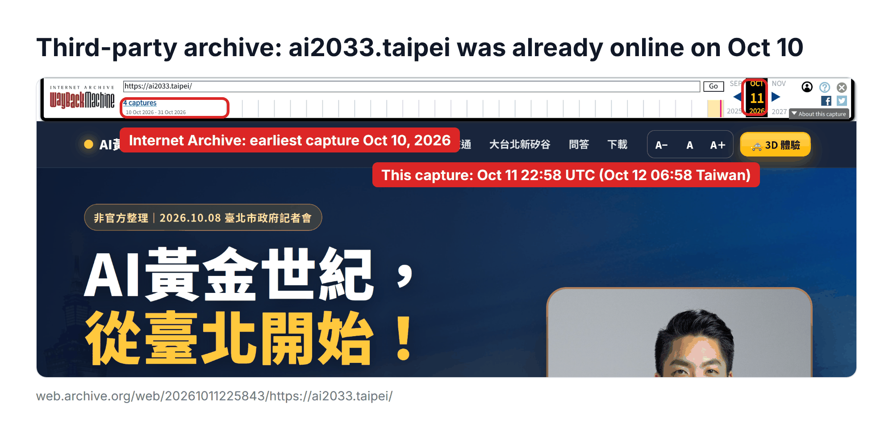
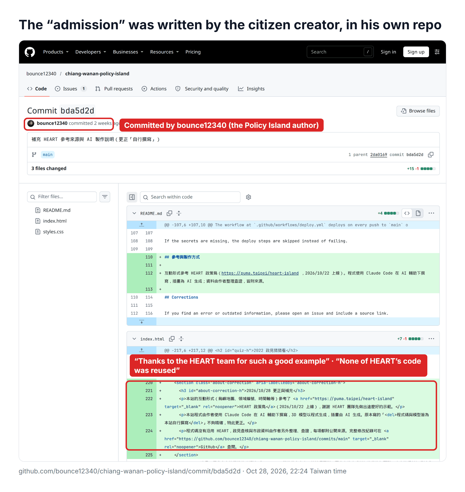
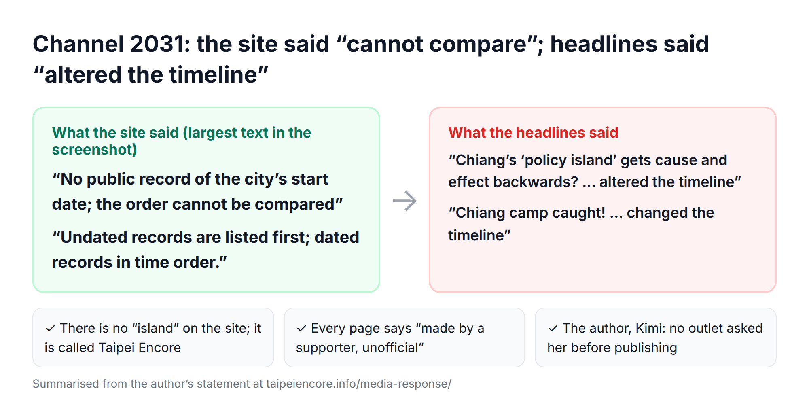

*Some background for readers outside Taiwan: Taipei is electing its mayor in 2026. Mayor Chiang Wan-an is running for re-election; Puma Shen (沈伯洋) is the DPP candidate. I am a legislator and part of Mayor Chiang’s campaign. Shen’s team published an interactive site called the “HEART Policy Island”. Over the past two weeks, a claim spread online that I had copied it. You don’t have to take my word for anything below: every point links to a primary record. All times are Taiwan time (UTC+8).*

---

## The short version

1. **People were arguing about three different projects.** Different authors, different dates, different designs, cut together into one story.
2. **I built AI2033 Taipei AI Park on October 9.** GitHub’s server-side deployment log and the Internet Archive both show it, about 12 days before the HEART Policy Island went public. Neither its prompt nor its code mentions the Policy Island.
3. **The line “interaction feel: reference puma.taipei/heart-island” comes from a prompt that a citizen, Josh, wrote for his own project, “Taipei Policy Island”. I did not write it.** He credited the Policy Island’s interaction concept on his site from day one, and none of its code was reused.
4. **The screenshot that went around cut the author line off.** The bottom half was then re-captioned as “Ju-Chun Ko’s AI prompt”.

## Three projects in one table

| | AI2033 Taipei AI Park | Taipei Encore Stage | Taipei Policy Island (channel 2034) |
|---|---|---|---|
| Author | Ju-Chun Ko | Ju-Chun Ko | **Josh, a citizen creator** |
| Work started | Oct 9, 14:20 | Oct 23, 00:53 | Oct 23, 06:25 |
| Public | Deployed Oct 9, announced Oct 11 | Press event Oct 28 | Oct 24 |
| What it is | A 3D Taipei where you drive a taxi and watch Songshan Airport become an AI park | A TV set; each channel is a citizen’s AI-made site | Mayor Chiang’s record shown as an island map |
| Relation to HEART | About 12 days earlier; the prompt never mentions it | A platform that hosts works and publishes each one’s prompt | Credited HEART’s interaction concept on day one; no code reused |
| Source | [dAAAb/ai2033.taipei](https://github.com/dAAAb/ai2033.taipei) | [dAAAb/encore-taipei](https://github.com/dAAAb/encore-taipei) | [bounce12340/chiang-wanan-policy-island](https://github.com/bounce12340/chiang-wanan-policy-island) |

## 1. AI2033 was online on October 9

On October 8, Mayor Chiang announced plans to relocate Songshan Airport and build the “Taipei AI Park”. The next afternoon, October 9, at 2:20 pm, prompted by a question from a member of the public, I sent my first request to the AI. The first version was finished at 4:06 pm, 1 hour and 46 minutes later. The process is documented in the public [making-of log](https://github.com/dAAAb/ai2033.taipei/blob/HEAD/docs/MAKING-OF.md).

Here is the prompt in full (translated). It is also published in the channel info for channel 2033 on the Encore Stage:

> Could you make a transcript, a PPT and PDF, and an interactive website with large, clear text, and give me public links? Thanks: “The AI golden century starts in Taipei!! Greater Taipei = Asia’s new Silicon Valley. Chiang Wan-an + Lee Szu-chuan = Greater Taipei’s new Silicon Valley” (link to the press conference video). You can use three.js to build a 3D simulation of Taipei, with an immersive page like a Taipei GTA (look it up) where you can experience Songshan Airport turning into the Taipei AI Park and 110 hectares of green space. Based on this announcement and official information online, make an amazing introduction site, with photos of Mayor Chiang. Thanks.

There is no Policy Island in it, because the Policy Island was not public yet. Three kinds of records that I cannot edit back it up:

| Record | Time (UTC) | Taiwan time | Recorded by |
|---|---|---|---|
| AI2033’s first deployment | 2026-10-09 07:11:33 | **Oct 9, 15:11** | GitHub’s servers ([public API](https://api.github.com/repos/dAAAb/ai2033.taipei/deployments)) |
| First capture of ai2033.taipei | 2026-10-10 15:17:32 | **Oct 10, 23:17** | Internet Archive ([capture](https://web.archive.org/web/20261010151732/http://ai2033.taipei/)) |
| Full-page capture of ai2033.taipei | 2026-10-11 22:58:43 | Oct 12, 06:58 | Internet Archive ([capture](https://web.archive.org/web/20261011225843/https://ai2033.taipei/)) |
| puma.taipei/heart-island still 404 | 2026-10-18 | Oct 18 | Internet Archive ([index](https://web.archive.org/cdx/search/cdx?url=puma.taipei/heart-island)) |
| First normal capture of puma.taipei/heart-island | 2026-10-22 04:13:02 | **Oct 22, 12:13** | Internet Archive |

GitHub writes its deployment times on its own servers; they are not commit dates that an author can set. The Internet Archive is a third party. I also published “[One sentence, one 3D Taipei](/en/ai2033-taipei/)” on this blog on the afternoon of October 11. This blog’s source is public too, and [that commit](https://github.com/DrJuChunKoO/blog.juchunko.com/commit/b8e1213) is timestamped Oct 11, 14:49.

So when I said I had built something in early October, I meant AI2033, and the records show it.

## 2. “It only started on the 23rd” is about the other two projects

Some people pointed to GitHub and said: “Their project only started in the early hours of the 23rd, after the Policy Island, so Ju-Chun Ko is lying.”

The projects that started early on the 23rd are the **Taipei Encore Stage** (first commit Oct 23, 00:53) and Josh’s **Taipei Policy Island** (first commit Oct 23, 06:25). I never claimed either of them was built in early October.

Using project B’s date to rebut what I said about project A is exactly the mix-up this post is about.

The Encore Stage is not an island, either. It is a TV set you flip through, and each channel is a site a citizen made with AI: channel 2026 is the Taipei Encore Night club, channel 2033 is AI2033, and channel 2034 is Josh’s Taipei Policy Island. It launched at a press event on October 28.

One outlet reported that “the co-author’s email shows Ju-Chun Ko is a co-author”. I built the Encore Stage and presented it myself at the press event; that was never hidden. The 46 commits of the Taipei Policy Island list only bounce12340, Josh Tsai and the AI assistant Claude as authors. I am not among them.

## 3. “Taipei Policy Island” is Josh’s work

The [Taipei Policy Island](https://chiang-wanan-policy-island.pages.dev/) has its own [GitHub project](https://github.com/bounce12340/chiang-wanan-policy-island). Josh started it on October 23 and submitted it to the Encore Stage on October 24; it passed review and went up as channel 2034.

Open the channel info for channel 2034 and the top says **by Josh**. The description ends with “**unofficial compilation, not affiliated with any party or the city government**”. Further down is his published prompt, whose first paragraph says “interaction feel: reference puma.taipei/heart-island”.

Screenshot only the bottom half, and the author disappears.

You can open [encore.taipei/2034/info/](https://encore.taipei/2034/info/) and see the whole panel yourself.

## 4. He said what inspired him from day one

Josh hid nothing.

- **Oct 23, 06:25, his first commit.** The site’s About section already said its “interaction concept follows ‘policy island’-style information visualisation sites”. ([commit](https://github.com/bounce12340/chiang-wanan-policy-island/commit/4d6cf3f))
- **Oct 24, submission to the Encore Stage.** He published his full prompt, reference URL included.
- **Oct 28, 22:24.** He added a “correction and note” himself ([commit](https://github.com/bounce12340/chiang-wanan-policy-island/commit/bda5d2d)), translated:

> This site’s interaction design (the island map, numbered policy areas, the timeline and so on) references the HEART Policy Island (launched 2026/10/22). Thanks to the HEART team for setting such a good example.
>
> None of HEART’s code was reused. The policy checks and city data were compiled and verified separately by the author, each with a public source.

In a newspaper op-ed’s photo caption, that note became “the update notice published by Mayor Chiang’s campaign, admitting the interaction design did reference…”. The commit was made by bounce12340 himself, in his own repository.

Borrowing an interaction feel you admire, saying where it came from, thanking the original team and writing your own code: in open-source communities that is called good manners, not plagiarism.

## 5. The irony: we published the prompt ourselves

Why could anyone see Josh’s prompt at all?

Because the Encore Stage asks every contributor to publish “the prompt used to make this channel” in the channel info, so that everyone can see how these sites were made with AI.

Someone took what we published voluntarily, cut off the author, put my name on it, and called it getting “caught”. If that works, who will publish their process next time?

The person hurt most by this was not me. It was Josh, an ordinary citizen who built a website in his own time and then faced a flood of plagiarism accusations. Josh, thank you again, and I am sorry.

## 6. About the word “followed”

On October 28 I said Shen’s team had “followed” with the same technology. I meant the tools: both sides use 3D web technology such as Three.js (the Policy Island’s page loads three.js). It is like two people using the same drawing software; it does not mean anyone copied anyone’s idea.

To be precise: the Policy Island’s author has said it was his side project over the National Day long weekend. AI2033 was built over the same long weekend. Each side built its own site and published it on its own. Nobody copied anybody.

Who came first can be checked against the records. Check them all the way down, and “Ju-Chun Ko’s prompt referenced the Policy Island” turns out never to have happened.

## Three questions to ask about any screenshot

1. **Who made it?** Look for the author line.
2. **Which project is it?** Do the name, address and date match?
3. **What does the full screen look like?** Where is the original link?

This time, every one of those questions had an answer, and every answer was public.

---

## A related case: the creator of channel 2031 was attacked too

Channel 2031 on the Encore Stage, “[Taipei Encore](https://taipeiencore.info/)”, is a separate site built by another supporter, Kimi. It has nothing to do with the Policy Island, but it was attacked over the same period.

Her policy comparison page said, in its largest type, “**No public record of the city’s start date; the order cannot be compared**”, with a note below: “Undated records are listed first; dated records in time order.” The page was then shared as “altering the timeline”, and the claim reached the headlines. SET News ran “Chiang’s ‘policy island’ gets cause and effect backwards? Netizens catch it allegedly stealing the sports station policy and altering the timeline”; the version republished on Mirror Media’s site read “Chiang camp caught! Allegedly stole the sports station policy and changed the timeline” (both translated).

In [her statement](https://taipeiencore.info/media-response/), Kimi points out:

- There is no “island” anywhere on her site. It is called Taipei Encore, and every page says it was made by a supporter and is unofficial.
- The screenshots in the news stories clearly show the line saying no start date could be found.
- No outlet contacted her before publishing. Her reply to the criticism was reported as spam and removed.

She also asked people not to harass the person who first raised the question. I agree. Criticise and question all you like, but aim at the facts, not at people. Kimi has since closed her site (she says it has done its job); her statement is still up and worth reading.

---

## Primary sources

**AI2033 Taipei AI Park**

- Source: [github.com/dAAAb/ai2033.taipei](https://github.com/dAAAb/ai2033.taipei)
- Making-of log: [docs/MAKING-OF.md](https://github.com/dAAAb/ai2033.taipei/blob/HEAD/docs/MAKING-OF.md)
- GitHub Pages deployment log (public API): [api.github.com/repos/dAAAb/ai2033.taipei/deployments](https://api.github.com/repos/dAAAb/ai2033.taipei/deployments)
- Internet Archive: [Oct 10, 2026 capture](https://web.archive.org/web/20261010151732/http://ai2033.taipei/), [Oct 11, 2026 capture](https://web.archive.org/web/20261011225843/https://ai2033.taipei/)
- Blog: “[One sentence, one 3D Taipei](/en/ai2033-taipei/)”, [commit b8e1213](https://github.com/DrJuChunKoO/blog.juchunko.com/commit/b8e1213)

**HEART Policy Island**

- Internet Archive capture index: [puma.taipei/heart-island](https://web.archive.org/cdx/search/cdx?url=puma.taipei/heart-island)

**Taipei Encore Stage**

- Source: [github.com/dAAAb/encore-taipei](https://github.com/dAAAb/encore-taipei), [first commit](https://github.com/dAAAb/encore-taipei/commit/1ca7a30)
- Channel 2034 info: [encore.taipei/2034/info/](https://encore.taipei/2034/info/)

**Taipei Policy Island (Josh)**

- Site: [chiang-wanan-policy-island.pages.dev](https://chiang-wanan-policy-island.pages.dev/)
- Source: [github.com/bounce12340/chiang-wanan-policy-island](https://github.com/bounce12340/chiang-wanan-policy-island)
- First commit (Oct 23, 06:25): [4d6cf3f](https://github.com/bounce12340/chiang-wanan-policy-island/commit/4d6cf3f)
- HEART credit added (Oct 28, 22:24): [bda5d2d](https://github.com/bounce12340/chiang-wanan-policy-island/commit/bda5d2d)

**My statements (in Mandarin)**

- Oct 28 launch event (Mirror TV livestream): [YouTube](https://www.youtube.com/watch?v=s0c3MJusxr4)
- Oct 29 clarification (China Times): [YouTube](https://www.youtube.com/watch?v=I8pFHd3zvFY)

**Coverage and op-eds (in Mandarin)**

- Liberty Times, Oct 29, 2026: [news report](https://news.ltn.com.tw/news/politics/breakingnews/5621927)
- Liberty Times, Oct 29, 2026: [news report](https://news.ltn.com.tw/news/politics/breakingnews/5622676)
- Liberty Times op-ed, Nov 5, 2026: [“Open source is not a fig leaf”](https://talk.ltn.com.tw/article/breakingnews/5625833)
- Liberty Times op-ed, Nov 11, 2026: [op-ed](https://talk.ltn.com.tw/article/breakingnews/5633859)

**The related case (channel 2031)**

- Kimi’s statement: [taipeiencore.info/media-response/](https://taipeiencore.info/media-response/)
- SET News: [original](https://www.setn.com/news/1930524) ([archived](https://web.archive.org/web/20261029131043/https://www.setn.com/news/1930524)); republished on Mirror Media: [link](https://www.mirrormedia.mg/external/setn_1930524)
