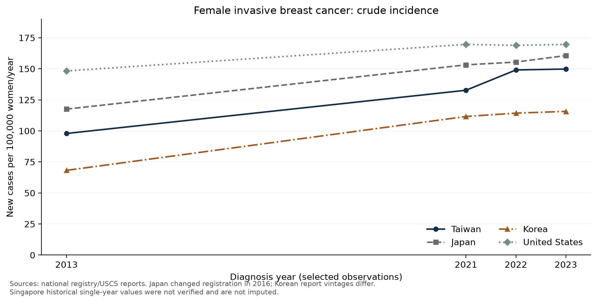
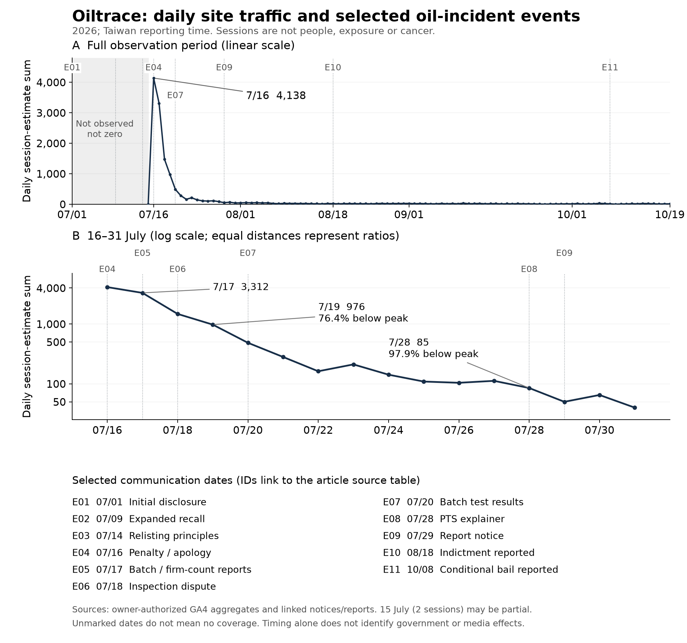
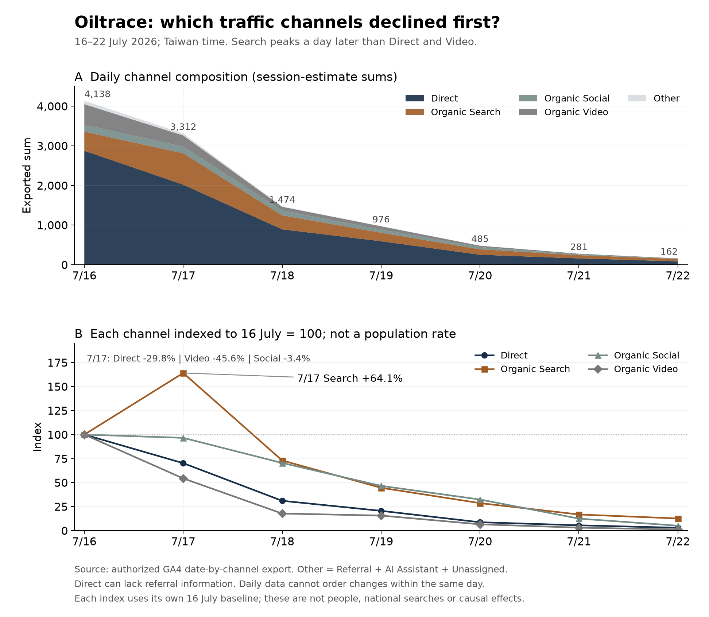

Recalling contaminated oil is necessary. So are tracing its distribution and investigating the companies involved. But another question deserves an answer: **what happens to the people who ate the oil, and to the person who stood over the stove preparing it for the entire household?**

We began with a hypothesis: could contaminated edible oil, including exposure during cooking, have contributed to women's cancer risks in Taiwan? We examined public laboratory disclosures, cancer registries, original scientific studies and household exposure scenarios.

Our conclusion is specific: **contamination is documented, and relevant exposure pathways are biologically plausible. We have not established a statistical association or causal link between this oil incident and Taiwan's breast-cancer increase.** Some findings support further investigation; others constrain the initial hypothesis. Both belong in the public record.

That evidentiary position still supports better exposure reconstruction, transparent surveillance and an administrative audit. A family should not have to prove that one particular bottle caused one particular cancer before authorities preserve records and investigate preventable exposure.

*Evidence cut-off: 20 October 2026. This is a public-data investigation and policy argument, not a clinical study. The cover is an AI-generated conceptual illustration.*

## What the oil records establish

In July 2026, Taiwan's Food and Drug Administration reported **8.1 micrograms of benzo[a]pyrene (BaP) per kilogram** in a soybean salad-oil batch supplied to downstream manufacturers, exceeding the cited **2.0 micrograms/kg** limit. This is not a measurement of every retail bottle sold by those manufacturers. [Original disclosure](https://www.fda.gov.tw/TC/newsContent.aspx?cid=4&id=t634379)

BaP is one member of the polycyclic aromatic hydrocarbon (PAH) family. A concentration four times a legal limit does not mean a fourfold probability of cancer. Dose, route, duration, age and other exposures matter.

Selected downstream observations include **4.3 and 3.8 micrograms/kg** in company-submitted finished-product tests disclosed by Taichung, and **2.6 micrograms/kg** in a Taipei retail sample. These targeted or self-submitted results cannot establish market prevalence. Samples may share an upstream source; multiple announcements are not automatically independent replication. [Taichung records](https://www.ud.taichung.gov.tw/1630364/3313371/3313372/nodeCp?nodeId=3319914); [sample-level source ledger](https://blog.juchunko.com/research/taiwan-bap-20261020/oil_test_observations.csv)

Historical exposure remains the critical gap. Sparse company records summarized for 2021–2026 do not establish years of consumer exposure at 8.1 micrograms/kg. A **14.8 micrograms/kg** intermediate degummed-oil value must not be substituted for a finished product used at home. Conversely, a few compliant or nondetect records cannot establish that every historical batch was unaffected. [Investigation report](https://www.fda.gov.tw/TC/includes/GetFile.ashx?id=f639209533902835574&iid=13727&type=3)

A 2026 test cannot by itself explain a cancer diagnosed in 2023. An earlier causal hypothesis needs actual earlier manufacturing, testing, distribution and use records, with appropriate allowance for disease development.

## Cancer is increasing, but the international comparison changes the story

“WHO 2000” in a cancer table names an **age-standard population**, not the world's average cancer incidence.

Taiwan's female breast-cancer crude rate rose from **97.91 to 149.82 per 100,000 women/year** between 2013 and 2023, an increase of **53.0%**. Its WHO-2000-age-standardized rate rose from **70.09 to 91.20**, or **30.1%**. Both are Taiwanese series. The denominator concerns female population, not only women who attended screening. [Taiwan's source data](https://www.hpa.gov.tw/Pages/ashx/GetFile.ashx?lang=c&type=1&sid=9e08758933474930a69e2946e17d63ea)

| Jurisdiction | 2013 crude rate | 2021 | 2022 | 2023 | Ten-year change | 2021–2023 two-year change |
|---|---:|---:|---:|---:|---:|---:|
| Taiwan | 97.91 | 132.72 | 149.07 | 149.82 | 53.0% | 12.88% |
| Japan | 117.51 | 153.19 | 155.43 | 160.65 | 36.7% | 4.87% |
| Korea | 68.20 | 111.60 | 114.30 | 115.70 | 69.6% | 3.67% |
| United States | 148.27 | 169.65 | 168.90 | 169.60 | 14.4% | -0.03% |
| Singapore | Not verified | Not verified | Not verified | 145.90 | — | — |

Rates are female invasive breast cancers per 100,000 women/year. Using a common **Segi world age standard** for 2023 gives **84.28** for Taiwan, **80.92** for Japan, **69.70** for Korea, approximately **97.39–97.46** for the US and **83.30** for Singapore. The narrow US range preserves uncertainty from suppressed small cells; it is not a confidence interval.

**Taiwan's long-term increase deserves attention. Korea has the larger 2013–2023 crude increase; Taiwan has the larger 2016–2023 and 2021–2023 changes among four verified comparisons.** Taiwan is not highest on the common-standard 2023 measure, and its WHO-standardized rate fell from 2022. Rankings depend on the window and measure; they do not establish a global or all-period lead.

Japan changed from estimates based on regional registries to national registration in 2016. Korean historical figures come from separate report vintages. Singapore covers citizens and permanent residents, and its inspected historical breast tables mostly pool several years; we did not invent annual figures from those averages. [Japan](https://ganjoho.jp/reg_stat/statistics/dl/index.html), [Korea 2013](https://pmc.ncbi.nlm.nih.gov/articles/PMC4843732/)/[2023](https://www.e-crt.org/upload/pdf/crt-2026-298.pdf), [CDC](https://gis.cdc.gov/cancer/uscs/), [Singapore](https://www.nrdo.gov.sg/publications/singapore-cancer-registry-annual-report-2023/). The downloadable table retains every annual source and limitation.

### Seven years from 2016, beside the ten- and two-year windows

To address the question about the period after the DPP took office in 2016, we added **diagnosis year 2016**, retaining all-age female invasive breast cancer per 100,000 women/year. The formula is **(2023 rate / starting-year rate − 1) × 100%**. These are endpoint changes, not annualized growth or fitted annual percent changes. Ten-year changes retain one decimal; seven- and two-year changes use two, calculated from unrounded inputs.

| Jurisdiction | 2016 crude rate | 2013–2023 ten-year change | 2016–2023 seven-year change | 2021–2023 two-year change |
|---|---:|---:|---:|---:|
| Taiwan | 109.07 | 53.0% | 37.36% | 12.88% |
| Japan | 145.55 | 36.7% | 10.38% | 4.87% |
| Korea | 85.00 | 69.6% | 36.12% | 3.67% |
| United States | 153.46 | 14.4% | 10.52% | -0.03% |
| Singapore | Not verified | — | — | — |

**Taiwan rose from 109.07 to 149.82 during 2016–2023, a 37.36% increase, largest among the four verified comparisons. Korea rose 36.12%, a difference of about 1.24 percentage points.** Japan rose 10.38% and the US 10.52%. Korea's 2016 female breast-cancer crude rate of 85.0 was checked in Table 2 of its original registry study; separate publication vintages remain a limitation. [Korea 2016 primary report](https://www.e-crt.org/upload/pdf/crt-2019-138.pdf)

**Taiwan also has the largest 2021–2023 two-year change among these four: 12.88%, against Japan's 4.87%, Korea's 3.67% and the US change of −0.03%.** Korea has the larger 2013–2023 ten-year increase. Singapore lacks verified single-year starting values and is not ranked. These selected-country descriptions do not establish a global ranking or a statistically significant Taiwan–Korea difference.

Taiwan's WHO-2000-standardized rate rose from **74.26 to 91.20 during 2016–2023, or 22.81%**. It answers a different question from the 37.36% crude increase. Age adjustment still does not control screening, detection or other risks.

Tsai Ing-wen took office on **20 May 2016**. Calendar-year 2016 includes time before and after the transfer, and is not a seven-year follow-up beginning on inauguration day. This retrospectively selected window describes change; it does not identify an effect of a party, policy or oil exposure. Cancer latency and earlier exposure histories remain relevant. [Primary inauguration record](https://www.president.gov.tw/NEWS/20440)

The two-year window is particularly sensitive to pandemic screening interruptions, delayed diagnosis and catch-up. Taiwan's crude rate rose approximately **12.32% in 2021–2022**, then **0.50% in 2022–2023**. The earlier jump cannot all be assigned to a new carcinogenic cause. Monthly diagnosis, stage, age and screening-route data are needed. Crude rates already normalize female population size, while retaining differences in age structure and registration.

### Is there a developed-country average to use as a benchmark?

Japan, Korea and the US provide individual comparisons over the same three windows. They do not represent all developed countries, and a simple mean of these selected jurisdictions is not an OECD average.

An OECD 2026 report supplies an **unweighted EU24 average** for breast cancer among women aged 15–49, standardized to the 2013 European population: **53.3 to 62.0**, approximately **+16%**, from 2000 to 2022 or the nearest available year. This is contextual evidence with different ages, standards and dates; it cannot be compared directly with our all-age crude rates. [OECD primary report, Section 2.4.3](https://www.oecd.org/en/publications/delivering-high-value-cancer-care_060869fe-en/full-report/recent-epidemiological-trends-in-the-cancer-burden_c435b1b1.html)

The inspected sources did not establish an OECD-wide average using the same all-age invasive-breast crude-rate definition and all three exact windows. We retain verified country comparisons and clearly labeled context, rather than fill that missing benchmark. The inputs and calculations are downloadable below.

## The household cook can carry an exposure burden that a per-diner average misses

Readers outside Taiwan may picture cooking oil primarily as something each person eats. In some Taiwanese households, one primary cook prepares several shared dishes for four, eight or more diners, sometimes using a gas hob, wok, and high-temperature stir-frying, pan-frying or deep-frying.

Her personal food portion is not the total amount of oil she handles at the stove. Preparing more servings may increase source emissions and time near the pan. It does not follow that she inhales all the BaP used for the family, or that her absorbed dose is multiplied directly by household size.

These practices are not universal. Steaming, boiling, shared cooking, eating outside the home and effective extraction all change the picture. “Asian cuisine is oily” is not an exposure measurement. A useful investigation measures temperature, oil mass and condition, cooking time, breathing-zone concentrations, fuel and hood performance.

Gendered labor deserves explicit attention. Taiwanese statistics based on the 2024 survey of women aged 15–64 report **2.00 hours/day of domestic work for partnered women and 0.73 hours for their partners**. These are broad domestic-work averages, not stove-time measurements or BaP doses. They support recording unpaid labor, rather than assigning one presumed cooking exposure equally to every diner. Men who cook, professional cooks and other household members also need appropriate consideration. [Official statistical publication, p. 20](https://www.iacsi.nat.gov.tw/fapi/AttFile?id=33636&type=AttFile)

## What the science supports—and what it does not

**Oil contaminants can enter cooking fumes.** A 2024 isotope experiment observed temperature-related migration of labeled PAH4 during frying at 160, 180 and 200°C. This supports a transfer pathway. It does not establish this incident's BaP-specific transfer rate, human absorption, or a validated extrapolation to hotter wok cooking. [Original study](https://doi.org/10.1016/j.psep.2024.05.072)

**Some studies associate cumulative cooking exposure with lung cancer.** A Taiwanese study reported an adjusted OR of 3.17 in its highest cumulative-cooking group among nonsmoking women. However, cases were recruited in 2002–2010, and the study did not measure this incident's oil or BaP. A Hong Kong study also found a high association. Cross-study effect-size differences cannot prove a uniquely Taiwanese contaminant. [Taiwan](https://doi.org/10.1038/s41598-020-63656-7), [Hong Kong](https://doi.org/10.1158/0008-5472.CAN-05-2932)

**Mammary exposure is plausible through systemic transport and metabolism.** A tracer study detected labeled material and DNA adducts in breast tissue after oral BaP administration to patients already awaiting breast-cancer surgery. This is not explained by breasts being anatomically close to lungs. Tissue access and adducts do not demonstrate new cancer incidence. [Human tissue study](https://doi.org/10.1016/S1383-5718(00)00134-0)

**Human breast-cancer epidemiology is mixed.** One French analysis found an association with modeled cumulative ambient-air BaP, while a later trajectory analysis did not find a BaP association. A large US prospective study found no positive association for meat-derived BaP. Different sources and exposure measures limit transfer to Taiwanese kitchen exposures. Contrary findings cannot be omitted. [French positive analysis](https://doi.org/10.1016/j.envint.2021.106399), [later analysis](https://doi.org/10.1186/s12940-024-01106-x), [US cohort](https://pmc.ncbi.nlm.nih.gov/articles/PMC3491884/)

The defensible description is **biological plausibility, a testable exposure pathway and heterogeneous external epidemiological support**. These are reasons to prioritize verification. They are not an observed statistical trend linking this incident to breast cancer.

## The household models also constrain our conclusion

At 8.1 micrograms/kg, actually eating 30 g of oil daily gives an external intake of **243 nanograms of BaP/day**.

We extended this to four- and eight-person scenarios, distinguishing near-pan and room air, daily cooking time, ventilation and source capture. Household oil handling ranges from 160 g/day in a reference scenario to 400 g/day in an elevated eight-person scenario, with an intentionally extreme 800 g/day stress test. These are assumptions, not measured Taiwanese means, population percentiles or absolute worst cases.

For a hypothetical **20-year adult exposure**, EPA route-specific coefficients give approximately **1.53–4.75 model-based additional lifetime general-cancer risks per million** across these four scenarios. These are not breast-cancer predictions or observed cases. A 20-year history at this concentration has not been established. The baseline is zero BaP rather than measured compliant-oil background, so this is not an incident-attributable increment.

**The modeled component does not quantitatively substantiate a large breast-cancer increase.** That finding belongs in the account. It also does not establish that complete cooking fumes are harmless: newly generated pollutants, other PAHs, aldehydes, burner emissions and actual hot-plume dynamics are outside the calculation. Paired oil and personal-air measurements are needed to calibrate it. [EPA assessment](https://iris.epa.gov/static/pdfs/0136tr.pdf); complete assumptions and outputs are in the research files below.

## Four duties that can be acted on now

### 1. Open the data and reconstruct exposure

Publish machine-readable batch and distribution records, sampling designs, original assays, detection limits and corrections. Preserve historical samples and warning records for independent blind replication. For cancer registries, disclose diagnosis-cohort-specific received counts, deduplication progress, unresolved edits and estimated completeness, with the method and revision schedule.

Taiwan has a history of roughly two-year final-report lags. A finalized 2023 report does not imply that authorities hold no records for 2024–2025. This audit still lacks current received counts and completeness for those diagnosis cohorts.

#### A 64-day activation postponement calls for faster surveillance and continuity review

Registry notices record an original **3 August 2026** activation date. The 11 August notice postponed it for adjustment and optimization, supplying CSV-upload testing and logic checks while formal reporting remained pending. The 5 October notice announced formal online reporting from **6 October**, **64 calendar days** after the original date. This is a notice-based timeline calculation, not our independent test of hospital-system availability. [Postponement notice](https://twcr.tw/?p=3552), [opening notice](https://twcr.tw/?p=3570)

**Testing, formal reporting, existing-record editing, cross-hospital review and annual-report publication are distinct workflows.** A March notice retained existing-record editing while new-year reporting, supplementary reporting and follow-up batches awaited the new system. Review for diagnosis year 2024 separately opened in March. The 64 days therefore do not establish a cessation of all cancer-data processing or a 64-day delay in annual-report publication. [Transition arrangements](https://twcr.tw/?p=3523), [2024-cohort review](https://twcr.tw/?p=3513)

**After contamination disclosure, authorities should prioritize faster receipt, validation and health follow-up, publish completeness, and assess qualified provisional releases.** Independent review should examine whether the postponement could have been prevented or shortened, disclose affected workflows, backlog and recovery deadlines, and evaluate parallel operation, temporary intake, pre-migration testing and surge staffing. This is a proposed administrative responsibility requiring more than a general reference to system modernization. The notices alone do not establish that all 64 days were avoidable or identify a deliberate motive.

The October notice set 30 November as the deadline for the first three 2026 reporting quarters; the fourth-quarter deadline remained pending. Public progress should extend beyond announcing the next deadline. Counts received, deduplication, unresolved edits and completeness for the 2024 and 2025 diagnosis cohorts would allow provisional-release feasibility to be assessed. Faster receipt supports a baseline and long-term follow-up; it does not remove cancer latency or automatically attribute newly detected or reported cases to recent contaminated oil.

### 2. Follow potentially exposed people proactively

An independently overseen team should first identify credible batch-linked exposure groups, then follow them over time. Primary household cooks, women with relevant exposure histories, occupational cooks and suitable susceptibility groups warrant considered inclusion. Age, screening, smoking, ambient pollution, reproductive and hormonal factors matter. Extra cancers detected after increased testing cannot all be attributed to the oil.

### 3. Evaluate preventive support and subsidies responsibly

Exposure-history assessment, counseling, access to established screening and clinically indicated care can be supported while research proceeds. Earlier or more frequent imaging for younger or otherwise selected women requires an independent assessment of net benefit, potentially through a monitored pilot with explicit eligibility.

More imaging can cause false positives, unnecessary biopsies, overdiagnosis and anxiety; some imaging also involves radiation. Purchasing an affected product alone does not yet establish that additional MRI or shorter mammography intervals improve outcomes. Existing high-risk clinical pathways remain important. [Screening benefits and limitations](https://www.uspreventiveservicestaskforce.org/uspstf/recommendation/breast-cancer-screening)

### 4. Audit administrative responsibility

Preserve and investigate when manufacturers, laboratories, certifiers and agencies learned of abnormalities; which duties applied; and which corrective actions followed. Internal review should have independent oversight, disclosed conflicts and a public recommendation tracker.

Criminal procedure, administrative responsibility and disease causation require different evidence. Progress in one does not replace a health investigation.

## First-party website data: follow-up must outlast the attention peak

The office participated in the Oiltrace public product-notice lookup. With owner authorization, on 20 October we read and exported the GA4 traffic-acquisition report for oiltrace.tw, requesting **1 July–19 October 2026** in the property's Taiwan reporting time zone. The first date present in the export is **15 July**. Missing earlier observations do not mean that earlier public interest was zero.

We compare two equal seven-day windows descriptively, rather than comparing a partial month with a full month. The initial window starts the day after the first observed date to avoid a potentially partial first day; this does not validate historical collection completeness.

| Period (Taiwan time) | Sum of exported session estimates | Daily mean |
|---|---:|---:|
| 16–22 July 2026 | 10,828 | 1,546.9 |
| 13–19 October 2026 | 100 | 14.3 |

The later window is **99.1% lower**. The daily peak was 16 July, approximately **4,138 sessions**. Use of this site was concentrated around an early peak and subsequently much lower. These windows were selected retrospectively; no formal change-point or causal analysis was performed.

**Sessions are not people, exposed purchasers or cancer outcomes.** Window values sum full-date-by-channel export rows; they are not separately deduplicated period totals. For the entire requested range, the report displayed 13,232 sessions, the date-by-channel rows summed to 13,245, and a channel-only export summed to 13,112. We preserve the discrepancy. GA4 uses HLL++ estimation for some counts, and estimates can differ across aggregation levels; we have not established that this alone explains the particular discrepancy. [Google's counting-method documentation](https://developers.google.com/analytics/blog/2022/hll)

This is one office-associated advocacy site with a self-selected audience. Publicity, links, platform recommendations, site changes and tracking configuration can affect traffic. Consent, blocking, bots, internal traffic and collection interruptions were not independently validated. **The data describe declining attention to this website; they do not establish deliberate diversion by government or media.** We supply no control site, comprehensive media-content series or design identifying that causal effect.

The policy relevance is continuity: health follow-up must outlast news attention. A durable public investigation and correction log can help sustain accountability, but traffic is not exposure or disease evidence. Deidentified daily site aggregates and a methods summary are linked below; raw GA exports remain private for audit.

### Put the daily curve beside dated events

The upper panel uses a linear scale for the full recorded period; the lower panel uses a logarithmic scale to inspect late July. Equal log-scale distances represent equal ratios, so slopes cannot be compared directly across panels. The shaded area is unobserved, not imputed as zero. Event IDs link to the source table.

The recorded peak was 4,138 on 16 July. **Six consecutive daily decreases ran from 17 July (3,312) through 22 July (162).** By 19 July, the daily sum was 976, **76.4% below the peak**; on 28 July it was 85, **97.9% below**. The initial decline therefore predates the 20 July batch-results notice and the 29 July notice concerning the investigation report and tests at other refineries. Those later notices cannot explain the onset of the recorded decline. This does not rule out earlier or other communication effects, which have not been estimated.

| ID | Publication date (2026) | Notice or reporting summary | Direct source |
|---|---|---|---|
| E01 | 1 July | Initial contamination disclosure, recall and inspection | [TFDA](https://www.fda.gov.tw/TC/newsContent.aspx?cid=4&id=t634379) |
| E02 | 9 July | Expanded recall of April–June oils/products; deadline noon 10 July | [TFDA](https://www.fda.gov.tw/TC/newsContent.aspx?cid=4&id=t634464) |
| E03 | 14 July | Conditional relisting principles discussed | [TFDA](https://www.fda.gov.tw/tc/newsContent.aspx?cid=4&id=t634488) |
| E04 | 16 July | Undeclared-batch penalty; company apology reported that evening | [TFDA](https://www.fda.gov.tw/TC/newsContent.aspx?cid=4&id=31599), [TVBS 21:52](https://news.tvbs.com.tw/life/3259627) |
| E05 | 17 July | More noncompliant-batch distribution reported in the morning; unchanged affected-firm count in the afternoon | [TVBS 08:22](https://news.tvbs.com.tw/life/3259893), [UDN 14:51](https://udn.com/news/story/124940/9634295) |
| E06 | 18 July | Central-local dispute over inspection timing reported | [UDN 16:33](https://udn.com/news/story/124940/9636178) |
| E07 | 20 July | Batch results and investigation/legislation plans published | [TFDA](https://www.fda.gov.tw/TC/newsContent.aspx?cid=4&id=t634524) |
| E08 | 28 July | Supply, processing and reporting explainer; updated 30 July | [PTS 12:12](https://news.pts.org.tw/article/819674/) |
| E09 | 29 July | Notice says investigation report is available; 30 compliant samples at three other refineries | [TFDA](https://www.fda.gov.tw/TC/newsContent.aspx?cid=4&id=t634555) |
| E10 | 18 August | Indictment of 15 people and four companies reported | [UDN 13:16](https://udn.com/news/story/124940/9698684) |
| E11 | 8 October | Conditional bail with electronic monitoring for four key defendants reported | [PTS 19:39](https://news.pts.org.tw/article/830547) |

New batches, distribution chains and political disputes continued to be reported during the decline. This is not evidence that coverage stopped; finding several articles also does not show that total coverage or reach stayed constant. These are exploratory selections, **not a complete media census**. Unmarked dates do not mean no coverage. The 16 July TVBS apology article credits CNA and is not an independent verification; the 28 July PTS article was later updated, so not every currently visible sentence can be assigned to its initial publication day.

Markers represent **publication dates**, not necessarily underlying occurrence dates; we did not verify when the investigation report first became downloadable. Daily GA cannot establish which article somebody saw or the order of events within a day. The 15 July observation may be partial, and launch publicity, shared links and tracking completeness are uncalibrated. A decline from 17 July is a descriptive observation, not a fitted statistical break, a national opinion series or an identified government effect. Distinguishing ordinary news decay, fading site promotion and other influences would require a comprehensive series of coverage, prominence and reach, finer source/medium detail, promotion records and suitable control sites.

### Which channel fell first? Search turned down a day later

The initial decline was not synchronized across channels. We preserve GA4's separate Organic Social and Organic Video classifications. Other combines Referral, AI Assistant and Unassigned. Each cell is an exported session estimate, not a count of distinct visitors.

| Date (2026) | Direct | Organic Search | Organic Social | Organic Video | Other | Sum |
|---|---:|---:|---:|---:|---:|---:|
| 16 July | 2,875 | 482 | 176 | 517 | 88 | 4,138 |
| 17 July | 2,019 | 791 | 170 | 281 | 51 | 3,312 |
| 18 July | 893 | 352 | 124 | 92 | 13 | 1,474 |
| 19 July | 592 | 215 | 82 | 81 | 6 | 976 |
| 20 July | 251 | 138 | 57 | 34 | 5 | 485 |
| 21 July | 159 | 81 | 22 | 16 | 3 | 281 |
| 22 July | 85 | 61 | 9 | 6 | 1 | 162 |

**From 16 to 17 July, Direct fell by 856 (−29.8%) and Organic Video by 236 (−45.6%). Organic Social fell by only six (−3.4%), while Organic Search rose by 309 (+64.1%).** Search reached its seven-day peak on 17 July, then fell to 352 on 18 July (−55.5% from 791). Direct and Video therefore had substantial daily decreases on 17 July, with Social slightly lower; Search turned down a day later. Daily observations cannot order the changes within 17 July. Substantial here describes magnitude, not a statistical significance test.

The upper panel shows absolute amounts; the lower panel sets each channel's own 16 July value to 100 so that Direct's larger volume does not hide Search's trajectory. The total fell by 826 on 17 July. Direct and Video together fell by 1,092, partly offset by rising Search: these are arithmetic changes, not independent causal contributions adding to 100%. The seven-day sum remains 10,828. All four main channels have an exported row on every date. Missing rows in some other channels contribute nothing to the exported-row sum; their absence does not establish zero real traffic.

**Direct does not mean only typed URLs, and it cannot be relabeled as LINE or Facebook sharing.** Missing tagging or referral information, redirects and blocking can affect attribution. Organic Social and Video are not national platform-use measures. Organic Search counts entries to this site, without search terms, impressions or a national query series; its increase cannot be extrapolated to the whole population's interest. [Google channel definitions](https://support.google.com/analytics/answer/9756891?hl=en), [Direct limitations](https://support.google.com/analytics/answer/15258820?hl=en)

The composition is compatible with fading link publicity followed by delayed search, but source/medium detail, promotion records and a control group are missing. That mechanism is unconfirmed. The data do correct the idea that every entrance lost attention together on 17 July.

### What other news competed for attention on 16–22 July?

We checked dated reporting, weekly news reviews and the written descriptions of PTS evening-news bulletins distributed through Apple Podcasts. The following are source-linked candidate topics, not a ranking by national reach. Dated coverage establishes their presence; importance alone does not establish displacement of oil-related attention.

| Date (2026) | Potential competing topic | Timing relative to site traffic |
|---|---|---|
| 16 July | [Housing-loan policy](https://news.pts.org.tw/article/817903) and [TSMC earnings news](https://udn.com/news/story/7314/9636506) | Same day as the recorded peak; a complete earlier baseline is unavailable |
| 17 July | [Taiwan stocks fall about 2,953 points](https://www.cna.com.tw/news/afe/202607170132.aspx); also [PTS evening coverage](https://news.pts.org.tw/article/818200) | Direct/Video fall that day, but site Search still rises |
| 17–18 July | [Hualien Wanli Creek barrier-lake warnings and overflow forecasts](https://news.pts.org.tw/article/818246), also in the [17 July synopsis](https://podcasts.apple.com/us/podcast/%E6%99%9A%E9%96%93%E6%96%B0%E8%81%9E%E9%80%9F%E5%A0%B1-20260717/id1519821634?i=1000777190737) | Overlaps early decline; forecasts do not establish an actual disaster at that time |
| 20 July | [World Cup final and aftermath](https://news.pts.org.tw/article/818372) | Later than onset; final-day reporting alone cannot explain the initial 17 July fall |
| 21 July | [Indictment reporting involving a former TSMC manager](https://news.pts.org.tw/article/818621) | Later than onset; an indictment is not a final conviction |
| 22 July | [Potential Typhoon Hongxia formation and impact forecast](https://podcasts.apple.com/us/podcast/%E6%99%9A%E9%96%93%E6%96%B0%E8%81%9E%E9%80%9F%E5%A0%B1-20260722/id1519821634?i=1000777855252) | Later than onset; this records a forecast |

To go beyond selecting individual major stories, we inspected the same publisher's written bulletins for **all five weekdays** in the seven-day window. The program describes weekday publication; this does not cover weekend television or other daily programs. The positions below are **written-synopsis positions, not verified broadcast running order, airtime or audience reach**.

| Date | First listed item | Oil / food-policy position | Original synopsis |
|---|---|---|---|
| 16 July | Housing-loan policy | Oil distribution and affected firms: fourth | [16 July](https://podcasts.apple.com/ca/podcast/%E6%99%9A%E9%96%93%E6%96%B0%E8%81%9E%E9%80%9F%E5%A0%B1-20260716/id1519821634?i=1000777036703) |
| 17 July | Intraday stock-market plunge | Premier's Zhonglian apology and administrative responsibility: third | [17 July](https://podcasts.apple.com/us/podcast/%E6%99%9A%E9%96%93%E6%96%B0%E8%81%9E%E9%80%9F%E5%A0%B1-20260717/id1519821634?i=1000777190737) |
| 20 July | Food-safety legislation debate | Broader food policy: first; synopsis does not explicitly name Zhonglian | [20 July](https://podcasts.apple.com/us/podcast/%E6%99%9A%E9%96%93%E6%96%B0%E8%81%9E%E9%80%9F%E5%A0%B1-20260720/id1519821634?i=1000777533107) |
| 21 July | Municipal food-safety meeting | Food-safety meeting: first; problem-oil collective litigation: second | [21 July](https://podcasts.apple.com/us/podcast/%E6%99%9A%E9%96%93%E6%96%B0%E8%81%9E%E9%80%9F%E5%A0%B1-20260721/id1519821634?i=1000777686439) |
| 22 July | Relisting of 19 oil batches | Oil relisting: first | [22 July](https://podcasts.apple.com/us/podcast/%E6%99%9A%E9%96%93%E6%96%B0%E8%81%9E%E9%80%9F%E5%A0%B1-20260722/id1519821634?i=1000777855252) |

Oil and broader food-policy topics remain visible in this bounded sample. The Zhonglian item is even earlier in the 17 July written list than the oil item on 16 July. This does not establish unchanged prominence across outlets, but it does not support equating falling site traffic with the disappearance of oil coverage. Apple Podcasts distributes the same publisher's material; it is not a second independent newsroom. These are pages checked on 20 October, not immutable broadcast transcripts; later synopsis revisions cannot be ruled out.

**Other major stories offer a plausible attention-competition hypothesis, but their actual displacement effect has not been estimated.** Stock-market and barrier-lake reporting merit further testing. Later World Cup, indictment and typhoon items cannot alone account for the 17 July onset. Fading site promotion, day-of-week effects, attribution changes and ordinary attention decay remain alternative explanations.

A stronger study would collect daily cross-outlet coverage, front-page/homepage duration and reach, alongside search trends, source links and comparison sites with similar launch publicity. It could test attention displacement while separating issue visibility from referrals to this particular site. Even an identified displacement effect would require additional evidence to establish deliberate manipulation.

## Make the unanswered questions answerable

An unsupported causal accusation can damage the trust of affected families. Leaving historical exposure permanently untraceable is also unacceptable.

Our proposal is concrete: **build an auditable chain of records, measure the people actually standing at the stove, and publish positive, negative and uncertain findings alike.** A credible investigation must be capable of weakening the hypothesis as well as strengthening it.

## Research files and disclosure

- [Five-country breast-cancer comparison (CSV)](https://blog.juchunko.com/research/taiwan-bap-20261020/breast_five_countries.csv)
- [Original annual sources, standards and limitations (JSON)](https://blog.juchunko.com/research/taiwan-bap-20261020/country_inputs.json)
- [Oil-test observations and limitations (CSV)](https://blog.juchunko.com/research/taiwan-bap-20261020/oil_test_observations.csv)
- [Household scenarios and parameters (CSV)](https://blog.juchunko.com/research/taiwan-bap-20261020/household_scenarios.csv)
- [Claim and inference ledger (JSON)](https://blog.juchunko.com/research/taiwan-bap-20261020/claim_ledger.json)
- [Oiltrace daily site aggregates (CSV)](https://blog.juchunko.com/research/taiwan-bap-20261020/oiltrace_daily_sessions_20261020.csv)
- [Attention calculations, aggregation discrepancies and limits (JSON)](https://blog.juchunko.com/research/taiwan-bap-20261020/oiltrace_attention_summary_20261020.json)
- [Selected event dates, direct sources and archive hashes (JSON)](https://blog.juchunko.com/research/taiwan-bap-20261020/oiltrace_event_timeline_20261020.json)
- [Descriptive daily-change and timing calculations (JSON)](https://blog.juchunko.com/research/taiwan-bap-20261020/oiltrace_timeline_analysis_20261020.json)
- [Daily channel aggregates, 16–22 July (CSV)](https://blog.juchunko.com/research/taiwan-bap-20261020/oiltrace_channels_20260716_20260722.csv)
- [Channel changes, missing rows and inference limits (JSON)](https://blog.juchunko.com/research/taiwan-bap-20261020/oiltrace_channel_analysis_20261020.json)
- [Competing-news candidates, five-bulletin coding and archive hashes (JSON)](https://blog.juchunko.com/research/taiwan-bap-20261020/oiltrace_competing_news_20260716_20260722.json)
- [Ten-, seven- and two-year inputs and changes (CSV)](https://blog.juchunko.com/research/taiwan-bap-20261020/breast_growth_windows_2013_2016_2021_2023.csv)
- [Matched windows, primary sources and aggregate-benchmark limits (JSON)](https://blog.juchunko.com/research/taiwan-bap-20261020/breast_growth_windows_2013_2016_2021_2023.json)
- [Registry milestones, 64-day calculation and archive hashes (JSON)](https://blog.juchunko.com/research/taiwan-bap-20261020/reporting_system_milestones_20261020.json)
- [繁體中文版](https://blog.juchunko.com/zh/taiwan-bap-oil-womens-health/)

This inquiry arose from the office's food-safety and women's-health concerns; the office also participated in the oil-tracker civic lookup project. That advocacy context is disclosed. AI assisted retrieval, translation, calculations and drafting; it does not replace primary evidence, human measurements or expert review. The manuscript remains an unsubmitted, non-peer-reviewed draft.
