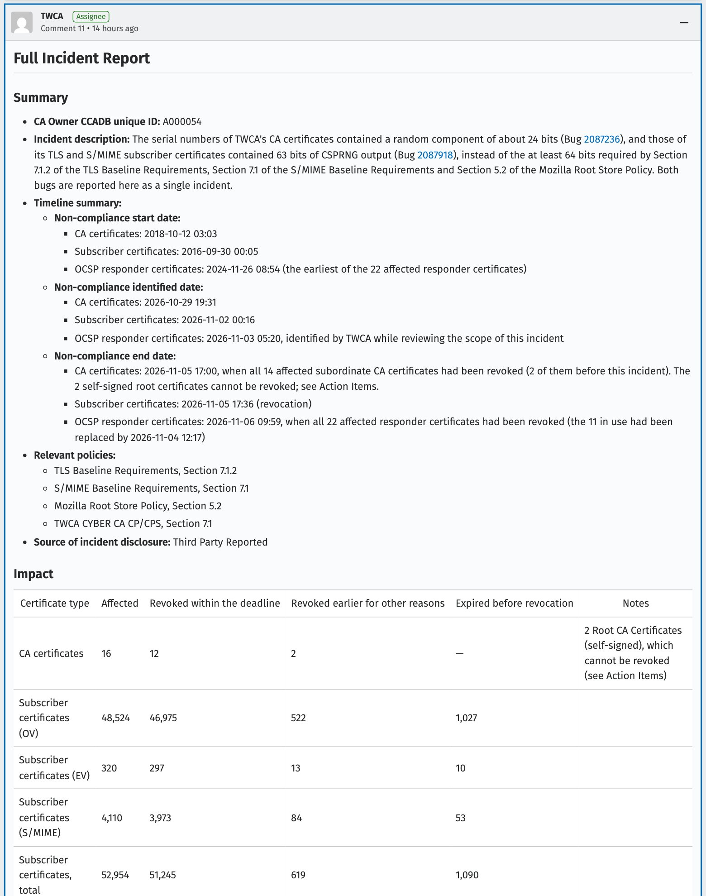

*On November 4 we published a video on the TWCA certificate incident and why it matters for Taiwan. On November 12, TWCA filed its full incident report on Mozilla's certificate incident tracker. This is the follow-up. Every number links to a primary source; the report itself is linked at the end.*

<iframe width="560" height="315" src="https://www.youtube.com/embed/YQfwdcyqgy0" title="The TWCA certificate incident: four serious problems and five demands" frameborder="0" allow="accelerometer; autoplay; clipboard-write; encrypted-media; gyroscope; picture-in-picture; web-share" referrerpolicy="strict-origin-when-cross-origin" allowfullscreen></iframe>

## The short version

TWCA's report concedes three things.

First, the serial numbers of its TLS and S/MIME subscriber certificates have carried only 63 bits of randomness since the 64-bit rule took effect in 2016, one bit short. The code treated a 64-bit random value as a signed integer and took its absolute value.

Second, its CA certificates (the "branch office seals" in our video) kept a serial format dating from 2011, with only about 24 random bits. TWCA's best guess is that it believed the 64-bit rule was aimed mainly at end-entity certificates.

Third, both problems were taken seriously only after outsiders reported them publicly on Mozilla's Bugzilla.

In total, <strong>52,954 subscriber certificates</strong> were affected, and TWCA dealt with all of them before the deadline. Two self-signed root certificates cannot be revoked, and their fate rests with Mozilla, Chrome and the other root programs. As of the morning of November 13 (Taipei time), no formal decision had been posted.

On the government side, Taiwan's Ministry of Digital Affairs (MODA) handled the emergency and promised a third-party audit and a contract-breach investigation. But since the November 6 deadline, it has not published the final replacement rate for government certificates, connection test results, the list of the 962 affected agencies, or a timeline for the audit.

*Image: summary and impact table of TWCA's full incident report. Source: [Mozilla Bugzilla 2087236, comment 11](https://bugzilla.mozilla.org/show_bug.cgi?id=2087236#c11), posted 2026-11-12 09:53 UTC. Screenshot used for commentary.*

## 1. How many certificates? Get the units right first

The report's impact table (all figures are numbers of certificates):

| Certificate type | Affected | Revoked within the deadline | Revoked earlier for other reasons | Expired before revocation |
| --- | --- | --- | --- | --- |
| CA certificates | 16 | 12 | 2 | (2 self-signed roots cannot be revoked) |
| TLS, OV | 48,524 | 46,975 | 522 | 1,027 |
| TLS, EV | 320 | 297 | 13 | 10 |
| S/MIME | 4,110 | 3,973 | 84 | 53 |
| <strong>Subscriber total</strong> | <strong>52,954</strong> | <strong>51,245</strong> | <strong>619</strong> | <strong>1,090</strong> |
| OCSP responder certificates | 22 | 22 | — | — |

That makes 52,992 certificates in all. Four things to keep straight:

1. <strong>These are certificates, not websites or agencies.</strong> One site may use several certificates, and one certificate may cover several hostnames. The figures cannot be converted into a number of affected websites.
2. <strong>The figures were revised.</strong> TWCA's November 6 progress update said it had revoked 52,816 subscriber certificates from the affected intermediates between November 2 and 5 ([comment 6](https://bugzilla.mozilla.org/show_bug.cgi?id=2087236#c6)). The full report re-counted on a different basis (certificates with non-compliant serials that were unexpired when the bug was filed, split into the three columns above) and states that the new figures supersede the earlier ones.
3. <strong>The government is only part of it.</strong> MODA said on November 2 that 962 government agencies and 9,772 website certificates were affected ([MODA press release](https://moda.gov.tw/press/press-releases/21226), in Chinese). For the financial sector, Taiwan's Financial Supervisory Commission said banks, securities firms and insurers held 4,190 TWCA certificates (Commercial Times, November 6).
4. <strong>Revoked does not mean replaced.</strong> Once the old certificate is revoked, a site works only after the new certificate is installed with its full chain.

## 2. Why nobody noticed for ten years: three causes

### An abs() call that ate one bit

From October 30, 2014, TWCA's online issuance system put an 8-byte (64-bit) random value into each subscriber certificate's serial number. The code treated that value as a signed 64-bit integer and applied `abs()`, which forces the most significant bit to 0 and leaves 63 bits.

CA/Browser Forum Ballot 164 has required at least 64 bits of CSPRNG output since September 30, 2016. From that date until October 22, 2026, every TLS and S/MIME subscriber certificate TWCA issued was non-compliant.

### You cannot see missing entropy in a single certificate

The serial numbers had the right length; one bit was simply always zero. Certificate linters cannot catch that. Only a look at the generation code can.

The report names two missed chances. In March 2019, after Google Trust Services, GoDaddy and others disclosed the same class of serial entropy defect, TWCA reviewed its code and concluded it was compliant. In November 2021, TWCA stated on Mozilla's public policy forum that the last 8 bytes of its serial numbers were randomly generated by an HSM and met the 64-bit requirement. Both times the defect went unnoticed.

### CA certificates: a 2011 format that never changed

CA certificates were issued by a separate offline system. From 2011 to 2024 their serials followed one structure: a fixed prefix, the issuance date, a run of zeros, a counter, and only the last 3 bytes, about 24 bits, of randomness.

Why was it never changed? The report says records from 2016 no longer exist and that, by TWCA's best guess, it believed the 64-bit rule targeted mainly end-entity certificates. The CA issuance checklist TWCA adopted in 2023 after another incident covers profile fields and linting results; serial generation is not a field, so it was left out.

### One passage worth a second read: an AI rewrite fixed it by accident

In July and August 2026, citing the number of incidents on Bugzilla, TWCA's management decided to consolidate its issuance systems and <strong>rewrote core components of the online system with AI assistance</strong>. The new code happened to produce 64-bit serials. It went live on October 22, quietly fixing the 63-bit defect. TWCA did not realize at the time that the old code had produced only 63 bits, and it did not notice the problem with CA certificates from the offline system.

I have long argued that we should use AI boldly, and rewriting legacy code with AI clearly worked here. But a fix nobody understood can just as easily run the other way next time: a rewrite that breaks something correct, with nobody noticing.

That is why I consider Action Item 8 the most important: unit tests based on NIST SP 800-22 that exercise the serial generation function itself, with the requirement that a test build with one bit fixed must fail. Whether code is written by people or by AI, it counts only if it can be verified.

## 3. Timeline (UTC)

- <strong>2011-06-10</strong>: Earliest CA certificate with the legacy format (about 24 random bits).
- <strong>2014-10-30</strong>: The online system starts putting an 8-byte random value in subscriber serials; in practice, 63 bits.
- <strong>2016-09-30</strong>: The 64-bit requirement takes effect. Neither process is changed.
- <strong>2018-10-12</strong>: First legacy-format CA certificate issued after the requirement took effect.
- <strong>2019-03</strong>: After similar incidents at other CAs, TWCA reviews its code and concludes it is compliant.
- <strong>2021-11-02</strong>: TWCA states on Mozilla's policy forum that its serials meet the 64-bit requirement.
- <strong>2026-07 to 08</strong>: Online issuance system rewritten with AI assistance.
- <strong>2026-10-22 07:37</strong>: Rewritten system deployed; subscriber serials compliant from then on.
- <strong>2026-10-29 19:31</strong>: Two outside researchers report the CA certificate serials on Bugzilla (2087236).
- <strong>2026-10-30 09:30</strong>: TWCA makes an emergency change so the offline CA system uses the online system's serial logic.
- <strong>2026-10-30 10:48</strong>: TWCA creates a new root, TWCA CYBER Root CA G3.
- <strong>2026-11-02 00:16</strong>: Another researcher reports the 63-bit subscriber serials (2087918).
- <strong>2026-11-03 05:20</strong>: TWCA itself finds the same problem in its OCSP responder certificates.
- <strong>2026-11-05 17:00</strong>: 12 affected CA certificates revoked.
- <strong>2026-11-05 17:36</strong>: Revocation of all unexpired affected subscriber certificates completed.
- <strong>2026-11-06 09:59</strong>: All 22 affected OCSP responder certificates revoked.
- <strong>2026-11-12 09:53</strong>: Full incident report posted, ahead of the 19:00 deadline.

## 4. Two root certificates still waiting on the browsers

TWCA CYBER Root CA and TWCA Global Root CA G2 are self-signed roots from 2022 that also carry the legacy serial format. Nothing above them can revoke them, so the report lists them as the only two "remaining valid" affected certificates. TWCA's plan (Action Item 3) is to reissue them with the same keys and new serial numbers, following the root programs' guidance, with a due date to be set once that guidance arrives.

The report also explains how it got here:

- On October 30, TWCA wrote to the Microsoft, Mozilla, Chrome and Apple root programs proposing same-key reissuance.
- While planning, it found that the CYBER Root's subject includes an attribute the current rules would require a reissued root to drop, which would change the name and break chaining for existing certificates. Microsoft's program also requires new roots to use a new key and subject name.
- With the intermediates due for revocation within seven days, TWCA decided that day not to wait and built G3 first. Hours later, Chrome replied that it would be willing to replace a same-key reissued root as a non-urgent change in a regular root store release. On October 31, Mozilla acknowledged the new plan and offered to prioritize its review of the new roots.
- TLS issuance now runs under TWCA CYBER Root CA G3, and S/MIME under a new TWCA SMIME Root CA G1. Until the new roots are in the browsers' stores, trust paths run through cross-certificates from the older TWCA Global Root CA.

The Chrome Root Program sent TWCA a list of questions on November 4. A few answers stand out:

- TWCA admits it "did not keep the Chrome Root Program informed in a timely and complete manner" of each concern and change of plan, and that its November 4 message to the root programs gave an incorrect TLS path and an incorrect reason, corrected on November 5.
- The new intermediates reuse the names of the 2024 ones. TWCA acknowledges this is contrary to the intent of the rules and commits to distinct names for future generations (SOP update due December 31).
- New CA serials contain exactly 64 bits of CSPRNG output, with no margin. TWCA commits to more than 64 bits by December 31.

As of the morning of November 13 (Taipei time), Bugzilla showed no formal decision from Mozilla or Chrome on the two legacy roots.

## 5. Was anything hacked?

Insufficient serial entropy is not the same as a breach.

- The researchers wrote from the start that they had no evidence of key compromise, certificate misuse or exploitation, and that a short serial does not by itself allow forgery with SHA-256 signatures.
- TWCA's report says it found no indication that the weak entropy was exploited or led to any security incident. All affected certificates are signed with SHA-256 or SHA-384, against which no practical collision attack is publicly known.
- MODA said on November 2 that no concrete security harm had occurred.

Serial randomness is the second lock against forgery. The first lock held, but the second should never have been missing a large piece, which is why the rules require revocation on a deadline.

## 6. A separate ticket: unauthorized access to an RA server

This is unrelated to the serial numbers, but it happened in the same weeks.

On October 29, TWCA self-reported indicators of unauthorized access to a Registration Authority server ([2086949](https://bugzilla.mozilla.org/show_bug.cgi?id=2086949)). Its full report (November 9 UTC) says:

- A legacy RA service, scheduled for decommissioning on May 29 but still running, used a third-party component with a remote code execution flaw. On the night of October 26 (Taipei time), someone exploited it over the internet and gained application privileges on the server.
- Using database credentials left unencrypted in a 2022 pre-upgrade configuration backup, the intruder connected to the back-end database and queried table structures, account privileges and row counts.
- TWCA says audit logs show no modification or export; a record-by-record check of the 553 certificates issued from October 26 to 28 found no unauthorized issuance; and it found no evidence that personal data was taken. Issuance was suspended for 4 hours 52 minutes as a precaution.

The report also concedes gaps: the vulnerability was public before both the May 14 penetration test and the August 7 vulnerability scan, and neither caught it; and the alert raised at 23:52 on October 26 was not picked up by operations staff until 06:58 the next morning. The related action items run to January 31, 2027.

## 7. The government: what it did, and what it hasn't explained

What MODA did:

- After the October 30 report, it told TWCA to produce new certificates within two days. TWCA reissued all 9,772 government certificates on November 1 and emailed them to each agency's contact, and MODA asked agency IT heads to push the replacement (MODA, November 2).
- It commissioned an independent third party to audit TWCA and said it would require fixes based on the results, investigate breach of contract, and impose penalties and seek compensation under the contract (same release).
- At 5 p.m. on November 5, the day before the deadline, MODA said 85% of the 9,772 certificates had been updated, with about 1,460 to go (Mirror Media, November 5).
- For the financial sector, the Financial Supervisory Commission said 95% had switched as of 2:30 p.m. on November 5 (Commercial Times, November 6).

What remains unexplained:

- <strong>Final numbers after the deadline.</strong> As of November 13, the only TWCA-related press release we could find on MODA's site was the one from November 2. The last figure before the deadline was 85%. Were the remaining 1,460 or so replaced? How many passed connection tests? Is there a list, or at least a breakdown, of the 962 agencies? None of this has been published.
- <strong>Warnings the day after.</strong> TWCA's own report says that some subscribers who manage certificates manually had not finished by the deadline, and some of their websites showed security warnings the next day. Which sites, whether any were government or financial services, and for how long: neither the report nor the government has said.
- <strong>The audit and the contract investigation.</strong> Scope, timing and results are unpublished. Seven of TWCA's ten action items are still open, most due by the end of December. The government should say whether its audit will verify them one by one.

On November 4 we spot-checked 54 commonly used Taiwanese websites. At 1 p.m., 12 of the 38 using TWCA certificates were still serving an intermediate about to be revoked; by 5:47 p.m., three were. It was only a sample, but it showed that the last days of replacement still depended on chasing sites one at a time by hand. Last year it was Chunghwa Telecom, after Chrome stopped trusting its new certificates; this year it is TWCA. Taiwan's Control Yuan wrote in its April 2026 investigation report that the government's "dual certificate" setup was "not an automated backup."

So the five demands in our video still stand. Three are the most urgent:

1. Publish the post-deadline numbers: replacement rate, connection test results, and a breakdown of affected agencies.
2. Publish the third-party audit and the outcome of the contract investigation, and check TWCA's ten action items one by one.
3. Give critical government systems backup across certificate authorities, adopt ACME for automated issuance, renewal and deployment, and rehearse switchovers regularly.

## Closing

TWCA revoked the affected certificates within the deadline, filed its report early, and wrote it candidly, down to admitting it had not kept Chrome properly informed. That deserves credit.

But both problems were found by outsiders after a decade of internal reviews missed them, and on the government side the emergency response happened while the last mile remains unexplained. I will keep following the two legacy roots and the third-party audit, and will update this post as things develop.

---

## Sources

- TWCA full incident report: [Mozilla Bugzilla 2087236, comment 11](https://bugzilla.mozilla.org/show_bug.cgi?id=2087236#c11) (2026-11-12 09:53 UTC), with attachments: [CA certificates](https://bugzilla.mozilla.org/attachment.cgi?id=9679812), [TLS certificates](https://bugzilla.mozilla.org/attachment.cgi?id=9679814), [S/MIME certificates](https://bugzilla.mozilla.org/attachment.cgi?id=9679813), [OCSP responder certificates](https://bugzilla.mozilla.org/attachment.cgi?id=9679815)
- TWCA progress update (revocations, 52,816 certificates): [Bugzilla 2087236, comment 6](https://bugzilla.mozilla.org/show_bug.cgi?id=2087236#c6) (2026-11-06 08:51 UTC)
- Original report by outside researchers Prasanth Sundararajan and Angelique Faye Loe: [Bugzilla 2087236, comment 0](https://bugzilla.mozilla.org/show_bug.cgi?id=2087236#c0) (2026-10-29 19:31 UTC)
- 63-bit subscriber serials: [Bugzilla 2087918](https://bugzilla.mozilla.org/show_bug.cgi?id=2087918) (2026-11-02 00:16 UTC, consolidated into 2087236)
- OCSP responder certificates: [Bugzilla 2080273, comment 5](https://bugzilla.mozilla.org/show_bug.cgi?id=2080273#c5)
- RA server incident, full report: [Bugzilla 2086949, comment 2](https://bugzilla.mozilla.org/show_bug.cgi?id=2086949#c2) (2026-11-09 21:51 UTC) and [comment 4](https://bugzilla.mozilla.org/show_bug.cgi?id=2086949#c4)
- Ministry of Digital Affairs press release, 2026-11-02 (in Chinese): [moda.gov.tw/press/press-releases/21226](https://moda.gov.tw/press/press-releases/21226)
- MODA's 85% figure at 5 p.m. on November 5: [Mirror Media, 2026-11-05](https://www.mirrormedia.mg/story/20261105-177fin-172426) (in Chinese)
- Financial Supervisory Commission, 4,190 certificates and 95% as of 2:30 p.m. on November 5: [Commercial Times, 2026-11-06](https://www.ctee.com.tw/news/20261106700161-439901) (in Chinese)
- CA/Browser Forum Ballot 164 (at least 64 bits of CSPRNG output from 2016-09-30) and TLS Baseline Requirements section 7.1: [cabforum.org](https://cabforum.org)
- Control Yuan investigation report, adopted 2026-04-14 (in Chinese): [cybsbox.cy.gov.tw](https://cybsbox.cy.gov.tw/CYBSBoxSSL/edoc/download/76191)
- Our video (spot-check method and full list in its description): [youtu.be/YQfwdcyqgy0](https://youtu.be/YQfwdcyqgy0)
