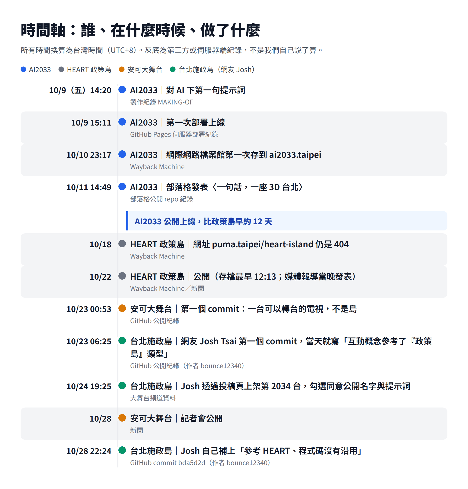
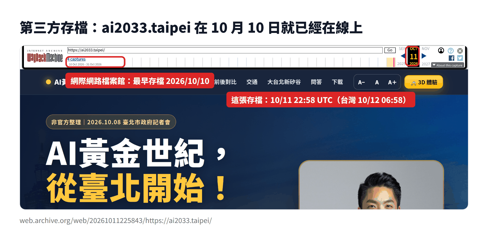
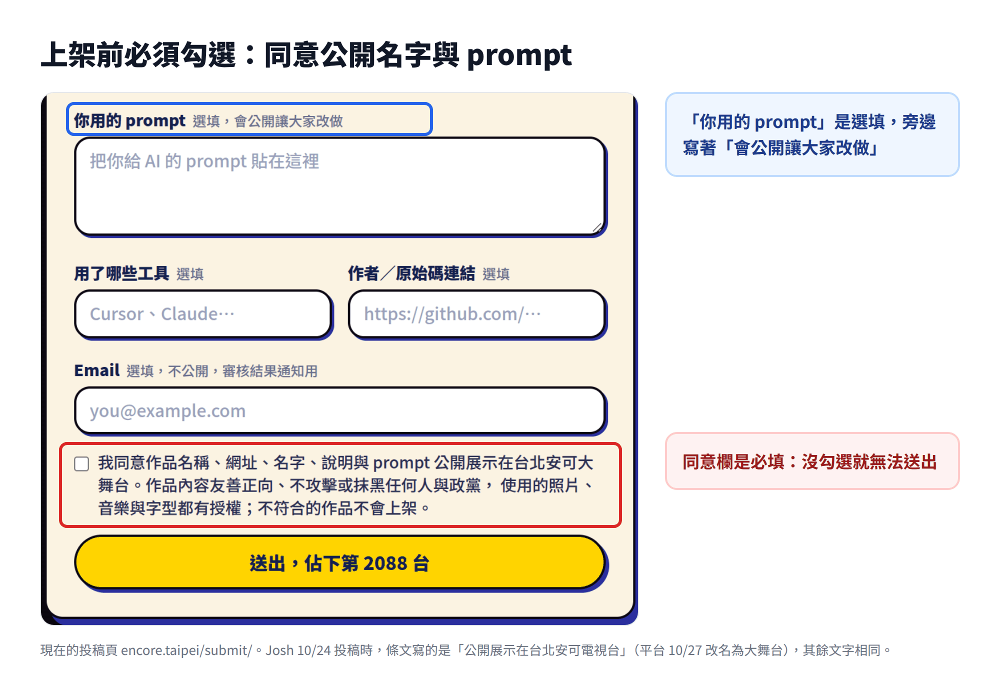
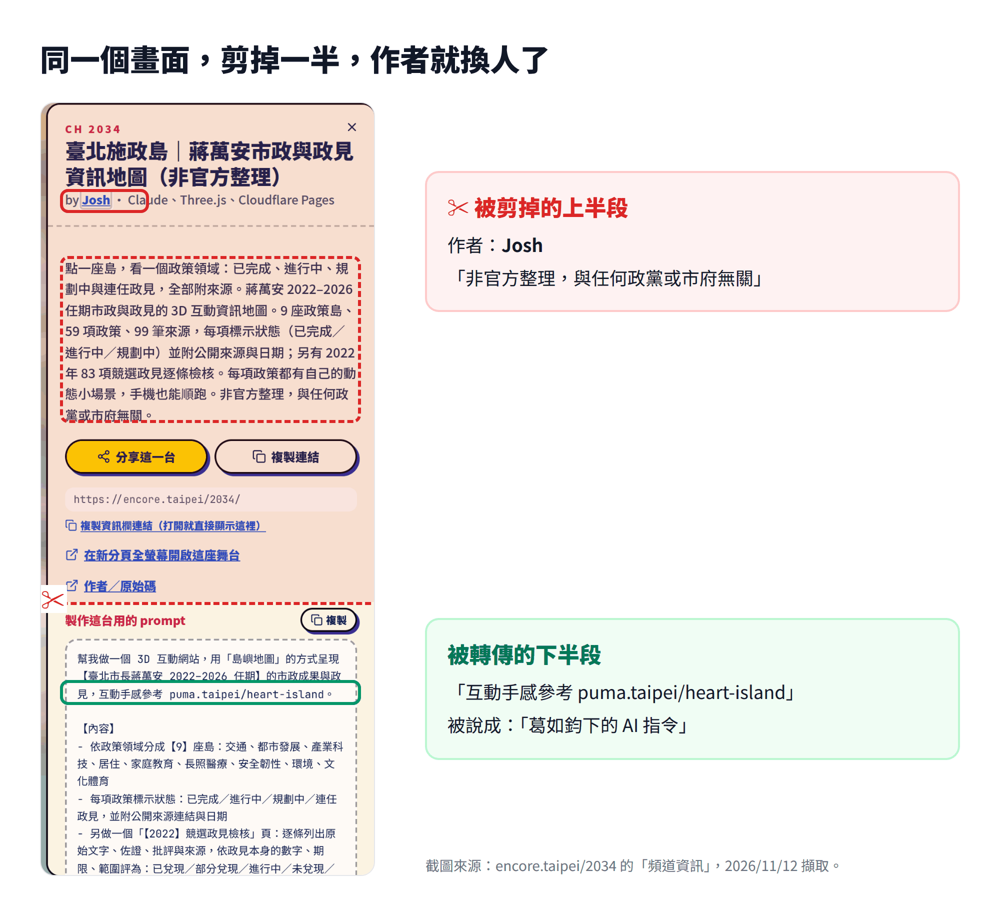
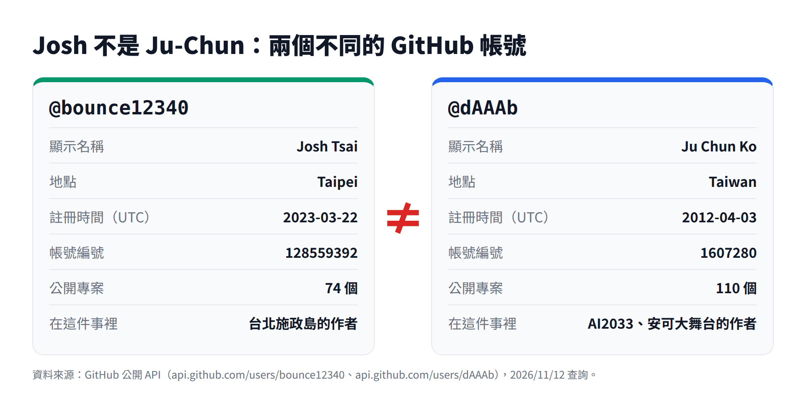
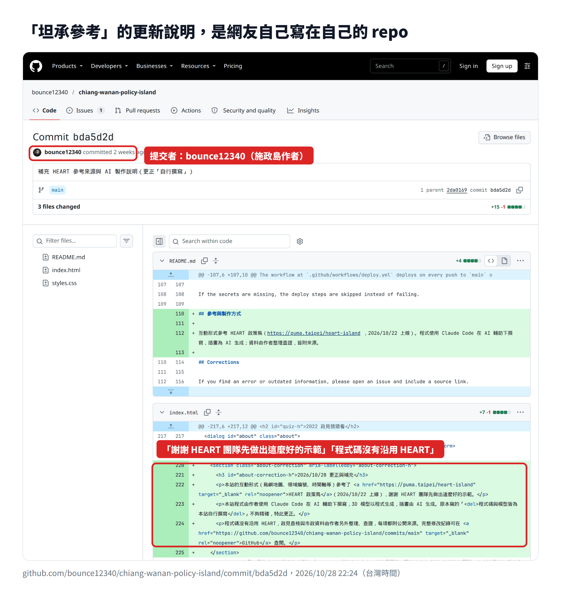
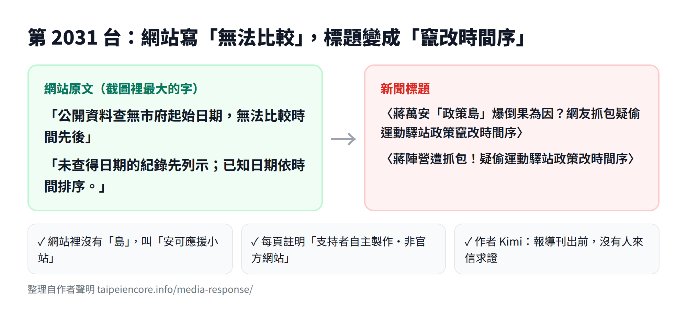

*這篇寫給這兩週在網路上看到「葛如鈞抄襲沈伯洋政策島」的朋友。不用相信我，下面每一條都附原始連結，點進去就能自己查。所有時間都換算成台灣時間（UTC+8）。*

---

## 一句話回答：沒有抄襲

被拿來當「抄襲證據」的那句「互動手感參考 puma.taipei/heart-island」，是**網友 Josh Tsai**（GitHub 帳號 bounce12340）為他自己的作品「**台北施政島**」寫的提示詞，不是我寫的。他透過安可大舞台的投稿頁上架作品，勾選同意公開名字與提示詞；網站從第一個版本就註明參考了政策島的互動概念，程式碼沒有沿用。

我做的是另一個網站 **AI2033 台北 AI 園區**，2026 年 10 月 9 日就上線，比 HEART 政策島早約 12 天，提示詞裡沒有一個字提到政策島。

## 先講結論

1. <strong>大家吵的，其實是三個不同的專案。</strong>作者不同、日期不同、長得也不一樣，卻被剪接成同一件事。
2. <strong>AI2033 是我 10 月 9 日做的。</strong>GitHub 伺服器的部署紀錄、網際網路檔案館的存檔都查得到。
3. <strong>台北施政島是 Josh Tsai 的作品。</strong>他有名有姓、有自己的 GitHub 帳號，是主動投稿、主動公開提示詞的創作者。
4. <strong>流傳的截圖，剛好從作者名字下面開始截。</strong>剩下的部分，被配上「葛如鈞下的 AI 指令」。
5. <strong>有人發現作者另有其人，就改口說「Josh 就是葛如鈞」。</strong>兩個帳號的紀錄攤開來，這也不是事實。

## 三個專案，一張表

| | AI2033 台北 AI 園區 | 安可大舞台 | 台北施政島（第 2034 台） |
|---|---|---|---|
| 作者 | 葛如鈞 | 葛如鈞 | **網友 Josh Tsai** |
| 開始製作 | 10/9 14:20 | 10/23 00:53 | 10/23 06:25 |
| 公開 | 10/9 部署、10/11 發文 | 10/28 記者會 | 10/24 投稿上架 |
| 長什麼樣 | 3D 台北，開小黃看松山機場變成 AI 園區 | 一台電視，每一台是一位市民用 AI 做的作品 | 用「島嶼地圖」呈現蔣萬安市長的施政 |
| 跟政策島的關係 | 早了約 12 天，提示詞沒有提到 | 收錄作品的平台，公開每一台的提示詞 | 作者第一天就註明參考互動概念，程式碼沒有沿用 |
| 原始碼 | [dAAAb/ai2033.taipei](https://github.com/dAAAb/ai2033.taipei) | [dAAAb/encore-taipei](https://github.com/dAAAb/encore-taipei) | [bounce12340/chiang-wanan-policy-island](https://github.com/bounce12340/chiang-wanan-policy-island) |

## AI2033 是什麼時候做的？

10 月 8 日，蔣萬安市長宣布遷移松山機場、打造「臺北AI園區」。隔天 10 月 9 日下午 2:20，我在一位網友的提問下，對 AI 送出第一則需求；下午 4:06，網站初版完成，前後 1 小時 46 分。過程寫在公開的[製作紀錄](https://github.com/dAAAb/ai2033.taipei/blob/HEAD/docs/MAKING-OF.md)裡。

這是當時給 AI 的提示詞，全文如下，也公開在大舞台第 2033 台的頻道資訊裡：

> 可否製作逐字稿 以及 PPT PDF 和 清晰字大的互動式網站 都給我公開連結 感謝：AI黃金世紀，從臺北開始！！大台北 = 亞洲新矽谷 蔣萬安 + 李四川 = 大台北新矽谷（附記者會影片連結）可以使用 three js 做台北的 3D 模擬 點進去可以有一個類似 台北 GTA（你上網查）的沈浸式互動頁面 可以體驗 松機變成 台北 AI 園區 和110公頃綠地的感覺 根據這個發表會和網路上的官方訊息 製作超級厲害的網頁介紹 要穿插蔣萬安市長的照片 謝謝

裡面沒有政策島，因為那時候政策島還沒公開。不只我這樣說，下面這些紀錄都不是我自己能填寫的：

| 紀錄 | 時間（UTC） | 台灣時間 | 誰記下的 |
|---|---|---|---|
| AI2033 第一次部署上線 | 2026-10-09 07:11:33 | **10/9 15:11** | GitHub 伺服器（[公開 API](https://api.github.com/repos/dAAAb/ai2033.taipei/deployments)） |
| ai2033.taipei 第一次被存檔 | 2026-10-10 15:17:32 | **10/10 23:17** | 網際網路檔案館（[存檔](https://web.archive.org/web/20261010151732/http://ai2033.taipei/)） |
| ai2033.taipei 完整頁面存檔 | 2026-10-11 22:58:43 | 10/12 06:58 | 網際網路檔案館（[存檔](https://web.archive.org/web/20261011225843/https://ai2033.taipei/)） |
| puma.taipei/heart-island 仍是 404 | 2026-10-18 | 10/18 | 網際網路檔案館（[查詢](https://web.archive.org/cdx/search/cdx?url=puma.taipei/heart-island)） |
| puma.taipei/heart-island 第一次正常存檔 | 2026-10-22 04:13:02 | **10/22 12:13** | 網際網路檔案館 |

GitHub 的部署時間是伺服器寫的，不是 commit 上可以自己改的日期；網際網路檔案館是第三方。另外，我 10 月 11 日下午就在這個部落格發了〈[一句話，一座 3D 台北](/zh/ai2033-taipei/)〉，這個部落格的原始碼也是公開的，[那次提交](https://github.com/DrJuChunKoO/blog.juchunko.com/commit/b8e1213)時間是 10/11 14:49。

所以我說「10 月初就做了」，說的是 AI2033，有紀錄可查。

## 「23 日凌晨才開始」說的是哪一個專案？

有人拿 GitHub 紀錄說：「他們的專案 23 日凌晨才開始，晚於政策島，所以葛如鈞說謊。」

23 日凌晨開始的，是**安可大舞台**（第一個 commit 10/23 00:53）和 Josh Tsai 的**台北施政島**（第一個 commit 10/23 06:25）。這兩個專案，我從來沒有說過是 10 月初做的。

拿 B 專案的日期，去反駁我講 A 專案的話，這就是張冠李戴。

安可大舞台也不是「島」。它是一台可以轉台的電視，每一台是一位市民用 AI 做的作品：第 2026 台是台北安可之夜，第 2033 台是 AI2033，第 2034 台是 Josh 的台北施政島。10 月 28 日在記者會上公開。

## 台北施政島是誰做的？

是 **Josh Tsai**。他的 GitHub 帳號是 [bounce12340](https://github.com/bounce12340)，所在地寫台北，2023 年就註冊，有 74 個公開專案。[台北施政島](https://chiang-wanan-policy-island.pages.dev/)有自己的 [GitHub 專案](https://github.com/bounce12340/chiang-wanan-policy-island)，10/23 動工。

10/24，他透過大舞台的[投稿頁](https://encore.taipei/submit/)上架作品。投稿表單最下面有一個**必填**的同意欄，沒勾就送不出去。他投稿當時的條文是：

> 我同意作品名稱、網址、名字、說明與 prompt 公開展示在台北安可電視台。作品內容友善正向、不攻擊或抹黑任何人與政黨，使用的照片、音樂與字型都有授權；不符合的作品不會上架。

（平台當時叫「台北安可電視台」，10/27 改名「台北安可大舞台」，其餘文字相同，[原始碼](https://github.com/dAAAb/encore-taipei/blob/d428948327b53ff0e6ce6c26766ea61398c6017a/src/tv/components/SubmitForm.tsx#L201-L204)查得到。）表單裡的「你用的 prompt」是**選填**，旁邊寫著「會公開讓大家改做」。Josh 選擇把提示詞填上、公開出來。

一個主動公開提示詞、響應開放透明的動作，就這樣被栽贓成抄襲。

其實 10/28 當晚，就有一位開頭寫「雖然我不喜歡葛如鈞，但是有一說一」的 Threads 網友，把事情講清楚了：「政策島事件其實涉及三個不同的專案，網友不要混在一起」，而且寫明「創作者是網友 Josh Tsai，GitHub 帳號為 bounce12340」。（[原文](https://www.threads.com/@ambrejaune99/post/DfEZAMdgW72)）連不支持我的人都查得到作者是誰。

## 流傳的截圖，剪掉了什麼？

在大舞台點開第 2034 台的「頻道資訊」，最上面是標題「臺北施政島……（非官方整理）」和作者 **by Josh**，簡介最後一句是「非官方整理，與任何政黨或市府無關」。再往下，才是他公開的提示詞，第一段就寫「互動手感參考 puma.taipei/heart-island」。

網路上流傳的截圖，剛好從作者名字下面開始截。

你可以自己打開 [encore.taipei/2034/info/](https://encore.taipei/2034/info/) 看完整的畫面。

## Josh 就是葛如鈞嗎？

不是。

作者另有其人這件事傳開後，有些帳號不願意相信 Josh 真有其人，開始硬湊：Josh 是 J 開頭，我的英文名字 Ju-Chun 也是 J 開頭，我的網站叫 juchunko.com，所以「Josh 就是葛如鈞自己」，所以「還是葛如鈞抄襲」。

把不同的人、不同的專案硬連在一起，這是霸凌連連看。紀錄是這樣的：

台北施政島的 46 個 commit 裡，作者只有 bounce12340、Josh Tsai，以及 AI 助手 Claude；我的帳號 dAAAb 一次都沒有出現。

至於有媒體說「透過共同作者的信箱發現，葛如鈞就是共同作者」：那是大舞台的紀錄。大舞台本來就是我做的，我在記者會上親自發表，從來沒有隱瞞。

## 施政島有沒有抄政策島？

Josh 從頭到尾都說了他參考了誰：

- **10/23 06:25，第一個 commit**，網站「關於本站」就寫著：「互動概念參考了『政策島』類型的資訊視覺化網站」。（[原始提交](https://github.com/bounce12340/chiang-wanan-policy-island/commit/4d6cf3f)）
- **10/24，投稿大舞台**時，他把完整提示詞一起公開，裡面寫明參考網址。
- **10/28 22:24**，他自己再補一段「更正與補充」（[原始提交](https://github.com/bounce12340/chiang-wanan-policy-island/commit/bda5d2d)）：

> 本站的互動形式（島嶼地圖、領域編號、時間軸等）參考了 HEART 政策島（2026/10/22 上線），謝謝 HEART 團隊先做出這麼好的示範。
>
> 程式碼沒有沿用 HEART，政見查核與市政資料由作者另外整理、查證，每項都附公開來源。

這段更正，後來在報紙投書的圖說裡，變成「台北市長蔣萬安競選團隊發布的互動網站更新說明，坦承互動形式確實參考……」。但提交者是 bounce12340 本人，寫在他自己的 repo。

參考別人做得好的互動手感、寫明出處、謝謝對方、程式碼自己寫。在開源社群，這叫做禮貌，不叫抄襲。

## 為什麼看得到他的提示詞？

因為大舞台鼓勵每一位投稿者公開「製作這台用的 prompt」，放在頻道資訊裡給所有人看，讓大家知道這些作品是怎麼用 AI 做出來的。

有人拿我們主動公開的東西，剪掉作者，換上我的名字，再說我們「被抓包」。如果這樣做可以得逞，以後還有誰敢把過程公開？

這次被傷得最深的不是我，是 Josh。一位用自己時間做網站的普通市民，在網路上承受了排山倒海的「抄襲」指控，還被說成根本不存在。在這裡再一次謝謝你，也向你致歉。

## 關於「跟著」

我 10 月 28 日說，沈伯洋團隊「跟著」採用了同樣的技術。我指的是工具：兩邊都用了 Three.js 這類 3D 網頁技術（政策島的網頁原始碼裡就載入了 three.js）。這就像大家都用同一套繪圖工具，不代表誰抄了誰的創意。

說得更精確一點：政策島的作者說，政策島是他國慶連假的 side project；AI2033 也是同一個連假做的。兩邊各做各的、各自公開，沒有誰抄誰。

誰先誰後，可以查紀錄。查到最後會發現，「葛如鈞的提示詞參考了政策島」這件事，從頭到尾沒有發生。

## 看到一張截圖，先問三個問題

1. <strong>這是誰做的？</strong>找作者欄。
2. <strong>是哪一個專案？</strong>名稱、網址、日期對得上嗎？
3. <strong>完整的畫面長怎樣？</strong>原始連結在哪裡？

這三個問題，這次每一個都有答案，而且都公開在網路上。

## 常見問題

### 葛如鈞有抄襲沈伯洋的 HEART 政策島嗎？

沒有。被當成「抄襲證據」的提示詞「互動手感參考 puma.taipei/heart-island」，是網友 Josh Tsai 為自己的作品「台北施政島」寫的。葛如鈞的作品 AI2033 在 2026 年 10 月 9 日就已上線，比 HEART 政策島公開早約 12 天，提示詞沒有提到政策島。

### 「台北施政島」是誰做的？

網友 Josh Tsai（GitHub 帳號 bounce12340）。他在 2026 年 10 月 23 日動工，10 月 24 日透過台北安可大舞台的投稿頁上架第 2034 台，投稿時勾選同意公開作品名稱、名字、說明與提示詞。

### Josh Tsai 就是葛如鈞嗎？

不是。bounce12340（Josh Tsai，2023 年註冊）和 dAAAb（葛如鈞，2012 年註冊）是兩個不同的 GitHub 帳號，各有各的專案與提交紀錄。台北施政島的提交紀錄裡沒有葛如鈞。

### 台北施政島有沒有沿用政策島的程式碼？

作者表示程式碼沒有沿用 HEART。他參考的是互動形式，網站從第一個版本就註明參考了「政策島」類型的網站，10 月 28 日又補上具名致謝。

### AI2033 是什麼時候上線的？

GitHub 伺服器紀錄顯示 2026 年 10 月 9 日 15:11（台灣時間）第一次部署，網際網路檔案館 10 月 10 日就存到 ai2033.taipei。HEART 政策島的網址 10 月 18 日仍是 404，10 月 22 日才公開。

### 台北安可大舞台是什麼？

我做的投稿平台，像一台可以轉台的電視，每一台是一位市民用 AI 做的網站。投稿者同意公開作品與提示詞，2026 年 10 月 28 日發表。

---

## 案外案：第 2031 台的作者也被網暴

大舞台第 2031 台「[安可應援小站](https://taipeiencore.info/)」，是另一位支持者 Kimi 自己做的網站，和施政島無關，卻也在同一段時間被攻擊。

她的政策對照頁上，用最大的字寫著「**公開資料查無市府起始日期，無法比較時間先後**」，下面還註明「未查得日期的紀錄先列示；已知日期依時間排序」。結果這頁先被網友轉傳成「竄改時間序」，接著上了新聞標題：三立新聞網〈蔣萬安「政策島」爆倒果為因？網友抓包疑偷運動驛站政策竄改時間序〉，鏡週刊網站轉載的版本則是〈蔣陣營遭抓包！疑偷運動驛站政策改時間序〉。

Kimi 在[她的聲明](https://taipeiencore.info/media-response/)裡指出：

- 網站裡沒有任何一座「島」，它叫「安可應援小站」，每一頁都註明「支持者自主製作・非官方網站」。
- 新聞附的截圖裡，「查無起始日期」那行字清清楚楚。
- 報導刊出前，沒有任何媒體來信求證；她回覆質疑的留言，還被檢舉成垃圾訊息移除。

她也特別請大家不要去打擾當初提出質疑的網友。我同意。可以批評、可以質疑，但請對著事實，不要對著人。Kimi 現在已經把小站收起來了（她說小站已經完成任務），那篇聲明還留著，值得一讀。

---

## 原始資料，自己查

**AI2033 台北 AI 園區**

- 原始碼：[github.com/dAAAb/ai2033.taipei](https://github.com/dAAAb/ai2033.taipei)
- 製作紀錄：[docs/MAKING-OF.md](https://github.com/dAAAb/ai2033.taipei/blob/HEAD/docs/MAKING-OF.md)
- GitHub Pages 部署紀錄（公開 API）：[api.github.com/repos/dAAAb/ai2033.taipei/deployments](https://api.github.com/repos/dAAAb/ai2033.taipei/deployments)
- 網際網路檔案館：[2026-10-10 存檔](https://web.archive.org/web/20261010151732/http://ai2033.taipei/)、[2026-10-11 存檔](https://web.archive.org/web/20261011225843/https://ai2033.taipei/)
- 部落格：〈[一句話，一座 3D 台北](/zh/ai2033-taipei/)〉，[提交紀錄 b8e1213](https://github.com/DrJuChunKoO/blog.juchunko.com/commit/b8e1213)

**HEART 政策島**

- 網際網路檔案館存檔列表：[puma.taipei/heart-island](https://web.archive.org/cdx/search/cdx?url=puma.taipei/heart-island)

**安可大舞台**

- 原始碼：[github.com/dAAAb/encore-taipei](https://github.com/dAAAb/encore-taipei)，[第一個 commit](https://github.com/dAAAb/encore-taipei/commit/1ca7a30)
- 投稿頁：[encore.taipei/submit/](https://encore.taipei/submit/)；10/24 當時的同意條文：[SubmitForm.tsx](https://github.com/dAAAb/encore-taipei/blob/d428948327b53ff0e6ce6c26766ea61398c6017a/src/tv/components/SubmitForm.tsx#L201-L204)
- 第 2034 台頻道資訊：[encore.taipei/2034/info/](https://encore.taipei/2034/info/)

**台北施政島（Josh Tsai）**

- 網站：[chiang-wanan-policy-island.pages.dev](https://chiang-wanan-policy-island.pages.dev/)
- 原始碼：[github.com/bounce12340/chiang-wanan-policy-island](https://github.com/bounce12340/chiang-wanan-policy-island)
- 第一個 commit（10/23 06:25）：[4d6cf3f](https://github.com/bounce12340/chiang-wanan-policy-island/commit/4d6cf3f)
- 補充參考來源（10/28 22:24）：[bda5d2d](https://github.com/bounce12340/chiang-wanan-policy-island/commit/bda5d2d)
- 兩個 GitHub 帳號的公開資料：[bounce12340](https://api.github.com/users/bounce12340)、[dAAAb](https://api.github.com/users/dAAAb)

**我的說明**

- 10/28 發布會（鏡電視直播）：[YouTube](https://www.youtube.com/watch?v=s0c3MJusxr4)
- 10/29 說明（中時新聞網）：[YouTube](https://www.youtube.com/watch?v=I8pFHd3zvFY)

**相關報導、投書與網友整理**

- 自由時報，2026/10/29：[〈才嗆完就被挖出下達AI指令抄襲沈伯洋 葛如鈞急改口〉](https://news.ltn.com.tw/news/politics/breakingnews/5621927)
- 自由時報，2026/10/29：[〈不認抄襲 葛如鈞僅向「台北施政島」作者致歉〉](https://news.ltn.com.tw/news/politics/breakingnews/5622676)
- 自由開講，2026/11/05：[〈葛如鈞，開源不是遮羞布，感謝不是道歉書！〉](https://talk.ltn.com.tw/article/breakingnews/5625833)
- 自由開講，2026/11/11：[〈對政治符號敏感 對創作權益無感的蔣團隊〉](https://talk.ltn.com.tw/article/breakingnews/5633859)
- Threads 網友整理，2026/10/28：[「政策島事件其實涉及三個不同的專案」](https://www.threads.com/@ambrejaune99/post/DfEZAMdgW72)

**案外案（第 2031 台）**

- Kimi 的聲明：[taipeiencore.info/media-response/](https://taipeiencore.info/media-response/)
- 三立新聞網：[原文](https://www.setn.com/news/1930524)（[存檔](https://web.archive.org/web/20261029131043/https://www.setn.com/news/1930524)）；鏡週刊網站轉載：[連結](https://www.mirrormedia.mg/external/setn_1930524)
