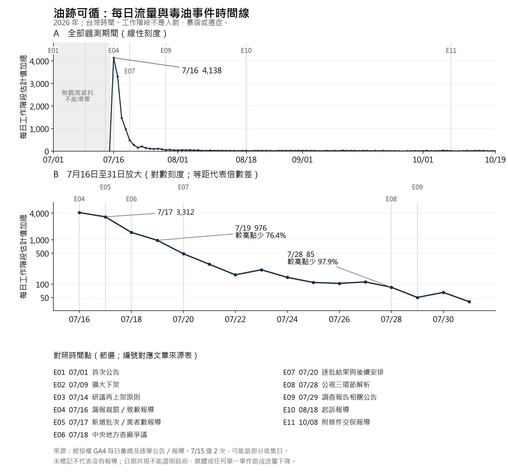
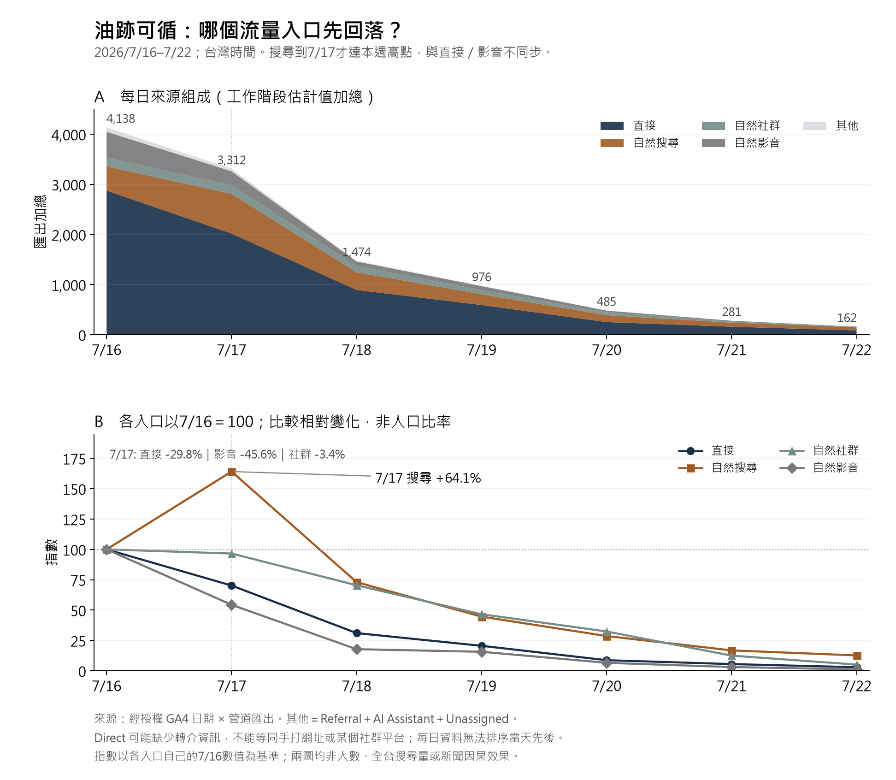

油品下架、退貨與追查廠商，都有必要。但我們還應該問：**曾經長期吃下這些油、站在爐前替全家煮飯的人，後來怎麼樣了？**

這次調查從一個很直接的疑問開始：台灣女性乳癌增加，是否可能與受污染食用油，以及烹調時的暴露有關？我們查了中央與地方檢驗資料、癌症登記、國際研究，也重算了家庭情境。

目前最誠實的結論是：**污染事實已經有具體紀錄，暴露途徑有科學上的合理性；但尚未建立「本案油品造成台灣乳癌增加」的統計關聯或因果證據。** 有些結果支持繼續追查，有些結果限制了原先的假說，兩者都必須公開。

這個證據程度，已足以要求政府把暴露調查與健康監測做得更完整。行政責任與資料透明，不應以先證明某位患者的癌症來自某瓶油，作為啟動門檻。

*資料查核截止：2026 年 10 月 20 日。本文是公開資料調查與政策倡議，不是臨床研究。封面為 AI 生成概念插畫。*

## 一、我們知道什麼，又還缺什麼？

食藥署 2026 年 7 月的公告，記載中聯供下游製造商使用的一批大豆沙拉油，自主檢出苯駢芘（benzo[a]pyrene，BaP）**8.1 微克／公斤**，高於公告所引的 **2.0 微克／公斤**限量。[原始公告](https://www.fda.gov.tw/TC/newsContent.aspx?cid=4&id=t634379)

BaP 是多環芳香烴（PAHs）的一種。超標值得嚴肅處理，但「濃度是限量的四倍」不能換成「罹癌機率四倍」。風險還取決於吃進或吸入多少、多久、什麼年齡，以及其他暴露。

地方資料也有下游產品的異常紀錄：台中公布的業者送驗結果包括 **4.3、3.8 微克／公斤**；台北通路抽樣另有 **2.6 微克／公斤**的觀察值。不同檢驗可能涉及相同上游來源，不能全部當成互相獨立的污染事件，也不能用這些針對性抽驗推算全市場污染率。[台中原始資料](https://www.ud.taichung.gov.tw/1630364/3313371/3313372/nodeCp?nodeId=3319914)；[逐筆來源與限制](https://blog.juchunko.com/research/taiwan-bap-20261020/oil_test_observations.csv)

最重要的缺口，是**歷史暴露**。調查報告中 2021–2026 年的少量業者紀錄，並沒有證明消費者長年都接觸到 8.1 的成品油。報告另有 **14.8 微克／公斤**的中間製程油值，也不能直接當成家庭吃到的濃度。反過來說，少量合格或未檢出的紀錄，也不足以證明所有歷史批次都沒有問題。[完整調查報告](https://www.fda.gov.tw/TC/includes/GetFile.ashx?id=f639209533902835574&iid=13727&type=3)

因此，2026 年檢出的油品，不能直接解釋 2023 年確診的癌症。要檢驗更早的影響，必須找到當年的批次、檢驗、供應與購買紀錄，並考慮疾病形成的時間。

## 二、台灣乳癌確實增加，但國際比較修正了我們的直覺

先釐清一個很容易看錯的地方：表格上的「WHO 2000」是**年齡標準人口**，不是 WHO 的全球乳癌平均值。

台灣 2013–2023 年，女性乳癌粗發生率從 **97.91 升至 149.82**，增加 **53.0%**；按 WHO 2000 年齡權重校正後，則從 **70.09 升至 91.20**，增加 **30.1%**。這兩條都是台灣的數字，分母以女性人口為基礎，不是去接受篩檢的人數。[台灣原始資料](https://www.hpa.gov.tw/Pages/ashx/GetFile.ashx?lang=c&type=1&sid=9e08758933474930a69e2946e17d63ea)

以下是每年每十萬女性的侵襲性乳癌**粗發生率**：

| 地區 | 2013 | 2021 | 2022 | 2023 | 十年增幅 |
|---|---:|---:|---:|---:|---:|
| 台灣 | 97.91 | 132.72 | 149.07 | 149.82 | 53.0% |
| 日本 | 117.51 | 153.19 | 155.43 | 160.65 | 36.7% |
| 韓國 | 68.20 | 111.60 | 114.30 | 115.70 | 69.6% |
| 美國 | 148.27 | 169.65 | 168.90 | 169.60 | 14.4% |
| 新加坡 | 未核得單年值 | 未核得單年值 | 未核得單年值 | 145.90 | 暫不計算 |

再把 2023 年統一成 Segi 世界年齡標準，台灣是 **84.28**，日本 **80.92**、韓國 **69.70**、美國約 **97.39–97.46**、新加坡 **83.30**。美國的小範圍來自公開資料隱藏少量病例後的計算上下限，不是信賴區間。

**台灣的長期增加值得調查，但這些資料不支持「台灣是五國最高、增長最快」。** 韓國的粗率增幅更大；台灣 2023 年的 WHO 標準化率也低於 2022 年。

日本 2013 年為推估值、2016 年後改為全國登記；韓國採各年報告，可能有版本差異；新加坡限公民與永久居民，其他年份主要查得多年合併資料。我們保留這些限制，也沒有把缺值填成零。[日本](https://ganjoho.jp/reg_stat/statistics/dl/index.html)、[韓國 2013](https://pmc.ncbi.nlm.nih.gov/articles/PMC4843732/)／[2023](https://www.e-crt.org/upload/pdf/crt-2026-298.pdf)、[美國 CDC](https://gis.cdc.gov/cancer/uscs/)、[新加坡](https://www.nrdo.gov.sg/publications/singapore-cancer-registry-annual-report-2023/)。完整各年來源見文末資料檔。

## 三、國外讀者需要理解：一個人可能在替整個家庭承擔烹調暴露

討論食用油，不應只算一位用餐者吃了幾公克。

在有些台灣家庭，一名主要烹調者會連續準備全家共享的菜餚，可能使用瓦斯爐、炒鍋，以及煎、炒、炸等較高溫方式。她吃進的是個人份量，爐前處理的卻可能是四人、八人甚至更多人的食物與油。烹調時間、離鍋距離和抽油煙效果，可能讓暴露分配與食物分配很不一樣。

這不是說每個台灣家庭都高油、高溫，也不是說煮飯是女性的責任。台灣同樣有蒸煮、外食、共同備餐與良好通風的家庭。真正需要研究的是這些差異，而不是用「亞洲人吃得油」代替測量。

在地家務分工確實值得納入。台灣根據 2024 年婦女生活狀況調查整理的資料顯示，有偶女性每日家務時間平均 **2.00 小時**，伴侶為 **0.73 小時**。但這是整體家務，不是煮飯時間，更不是油煙劑量。[原始統計出版品，第 20 頁](https://www.iacsi.nat.gov.tw/fapi/AttFile?id=33636&type=AttFile)

研究應該主動記錄：誰煮、替幾人煮、一天幾餐、累積幾年、油溫多少、油是否重複使用、爐具種類、排煙是否有效，以及呼吸帶實際測到什麼。

## 四、科學文獻支持哪些可能性？

**油中的污染物可能進入油煙。** 2024 年同位素實驗，在 160、180、200°C 條件下，觀察到標記 PAH4 向油煙轉移的比例隨溫度上升。但它研究的是特定油炸實驗；PAH4 轉移比例不是本案 BaP 的人體吸收率，也不能直接外推到更高溫快炒。[原始研究](https://doi.org/10.1016/j.psep.2024.05.072)

**長期烹調暴露與肺癌，有值得重視的研究關聯。** 台灣 2020 年論文，在不吸菸女性中觀察到較高累積烹調指標與肺癌的關聯，最高組 OR 為 3.17。但病例收於 2002–2010 年，沒有量到本案油品或 BaP；香港也曾觀察到高關聯，不能因此說只有台灣有獨特問題。[台灣研究](https://doi.org/10.1038/s41598-020-63656-7)、[香港研究](https://doi.org/10.1158/0008-5472.CAN-05-2932)

**乳房暴露在生理上有可能，原因是全身運輸與代謝。** 人體示蹤研究曾在已準備接受乳癌手術的患者口服標記 BaP 後，於乳房組織測得標記與 DNA 加合物。這不是因為乳房靠近肺，也不等於加合物一定變成癌症。[人體組織研究](https://doi.org/10.1016/S1383-5718(00)00134-0)

**人類乳癌流行病學證據並不一致。** 法國研究對長期室外空氣 BaP 有正向結果，另一次分析卻未見 BaP 關聯；美國大型前瞻研究對肉類來源 BaP 也沒有正向結果。不能只保留支持假說的論文。[法國正向研究](https://doi.org/10.1016/j.envint.2021.106399)、[後續分析](https://doi.org/10.1186/s12940-024-01106-x)、[美國研究](https://pmc.ncbi.nlm.nih.gov/articles/PMC3491884/)

所以，目前適合的學術描述是：**具有生物學合理性、可檢驗的暴露路徑，以及仍不一致的外部流行病學證據，足以形成優先驗證假說。** 尚不能寫成「本案已呈現乳癌風險增加的統計趨勢」。

## 五、把家庭情境算進去，模型也沒有給我們任意放大結論的理由

若每天實際吃進 30 公克、濃度 8.1 微克／公斤的油，外部 BaP 攝入量是 **243 奈克／天**。

我們進一步做了四人、八人的情境，納入家庭總用油、爐前時間、近鍋與房間兩個區域、排煙與通風。四人參考情境每天處理 160 公克油；八人高暴露情境為 400 公克，另設每天 800 公克的極端壓力測試。這些是明列假設，**不是台灣平均值、95 百分位，也不是真正最壞情境**。

在假設持續 20 年、使用 EPA 成人一般致癌風險係數的模型中，四種情境對該有限暴露成分的估計約為**每百萬人 1.53 至 4.75 的終生額外風險**。這不是乳癌專屬預測，不是實際患者數；20 年維持這個污染濃度也未獲證實。計算基準為零 BaP，而非實測合格油背景，因此還不能稱為本案的可歸因增量。

這個結果**不支持用目前模型解釋乳癌大幅增加**，必須如實寫出。但模型也沒有涵蓋全部油煙混合物、新生成污染物、其他 PAHs、醛類或真實熱羽流，不能據此宣布所有烹調暴露都安全。需要的是實際油品與呼吸帶的配對採樣，校準模型。[EPA 原始評估](https://iris.epa.gov/static/pdfs/0136tr.pdf)；完整參數與計算見文末研究檔案。

## 六、政府現在可以履行的四項責任

### （a）公開透明資料，加速清查與釐清

公開可供機器讀取的批次、流向、採樣方式、原始檢驗、偵測極限與修訂紀錄；保留歷史留樣及異常紀錄，讓不同實驗室能盲測複驗。癌症資料應分診斷年度公布已收件、去重、覆核與完整率估計，並說明何時能提供有限制的速報。

歷年癌登年報約兩年的發布落差，與 2026 年系統開放申報延後，都有可查紀錄；但這不能直接證明刻意掩蓋。也不能把公開完整資料只到 2023 年，說成機關手上只有 2023 年。[癌登系統公告](https://twcr.tw/?p=3570)

### （b）主動追蹤可能暴露的女性與主要烹調者

由有獨立監督的團隊，先重建有可信批次或供油紀錄的族群，再設計多年追蹤。把女性、主要家庭烹調者、職業廚師與具有既有高風險背景的人納入合理分層，控制年齡、篩檢、吸菸、空污、生育與荷爾蒙因素。不能把曝光後更多人去檢查、因此多檢出的癌症，全算成毒油造成。

### （c）評估預防性支持與補助，但不先承諾全面加做影像

可以先補助暴露史評估、健康諮詢、既有適當篩檢的可近性，以及臨床上有需要的後續診療。對年輕女性、特定暴露條件或原有高風險者，應由獨立專家評估更早或更頻繁影像的淨效益，必要時以有監督的試辦研究檢驗。

更頻繁並不必然更有益。偽陽性、切片、過度診斷、焦慮，以及部分檢查的輻射，都需要計入。單憑購油紀錄，目前不足以判定某人需要額外 MRI 或縮短乳房攝影間隔。[篩檢效益與限制參考](https://www.uspreventiveservicestaskforce.org/uspstf/recommendation/breast-cancer-screening)

### （d）進行行政調查，公開警訊與處理時間線

誰在什麼時間知道異常？法定或實務上的查核、通報與矯正措施是否做到？企業、驗證者、實驗室與中央地方各負什麼責任？內部調查應保全紀錄，並接受外部監督、揭露利益關係，定期公開改善進度。

刑事程序、行政責任與疾病因果，是三個需要各自證據的問題。任何一項程序進展，都不應取代健康調查。

## 七、第一手網站資料：關注度退潮之後，追蹤不能跟著停止

辦公室參與的「油跡可循」提供公開油品公告查詢。經授權，我們於 10 月 20 日讀取並匯出 oiltrace.tw 的 GA4 流量開發報表，查詢範圍為 **2026 年 7 月 1 日至 10 月 19 日**，資源時區為台灣時間。匯出資料最早出現於 **7 月 15 日**；更早沒有資料，不等於更早沒有人關心。

為避免拿不完整月份與整月相比，我們選取兩個各七天的描述性比較期間。第一段從最早觀測日的隔天開始，避開可能只有部分時間的首日；這不代表已驗證當時追蹤完整。

| 期間（台灣時間） | 匯出工作階段估計值加總 | 平均每天 |
|---|---:|---:|
| 2026/7/16–7/22 | 10,828 | 1,546.9 |
| 2026/10/13–10/19 | 100 | 14.3 |

後一段比前一段下降 **99.1%**；單日高點為 7 月 16 日，約 **4,138 次工作階段**。這顯示本站使用集中於早期高峰，後來大幅退潮。期間為事後選取，並未進行正式轉折點或因果分析。

**工作階段不是人數，更不是暴露人數或癌症患者數。** 以上加總來自「完整日期 × 管道」匯出列，不是另行去重的期間總數。全查詢期間的 GA 介面總數為 13,232，日期與管道各列加總為 13,245，僅按管道匯出的列加總則為 13,112；三者均保留，不強行湊齊。GA4 的部分計數使用 HLL++ 估計，不同彙總層級可能有差異，但我們未證明這是本次差異的唯一原因。[Google 計數方法說明](https://developers.google.com/analytics/blog/2022/hll)

這是與辦公室倡議有關、使用者自行選擇造訪的單一網站。宣傳、連結、平台推薦、網站改動與追蹤設定都可能影響流量；同意機制、阻擋工具、機器人、內部流量及追蹤中斷尚未獨立驗證。**數字支持「本站關注度明顯退潮」，不能證明「政府或媒體刻意轉移注意力」。** 我們沒有對照網站、完整媒體內容序列或可識別這項因果效果的設計。

這項觀察的公共意義是：健康追蹤需要跨越新聞熱度。它支持設立持續公開的調查進度與資料修訂紀錄，不能替代暴露與疾病證據。去除帳號識別資訊的每日網站彙總與方法摘要附於文末；原始 GA 匯出檔留作非公開核對。

### 把每日流量與事件時間點放在一起

下圖上半部採線性刻度呈現全部觀測期間，下半部採對數刻度放大七月下旬；對數圖的等距代表相同比例差，不能把兩幅圖的斜率直接相比。灰色區域是尚無觀測資料，沒有補零。事件編號對應下表逐筆來源。

在這份序列中，7 月 16 日為觀測高點 4,138；**7 月 17 日起連續六日下降，7 月 17 日為 3,312，7 月 22 日為 162。** 7 月 19 日已剩 976，比高點低 **76.4%**；7 月 28 日為 85，低 **97.9%**。因此，最初下滑早於 7 月 20 日逐批檢驗結果公告，以及 7 月 29 日關於調查報告與其他油廠抽驗的公告，不能把這兩則較晚公告當成「最初開始下降」的原因。這不排除更早或其他訊息的影響，也沒有估計它們的效果。

| 編號 | 發布日期（2026 年） | 公告或報導內容摘要 | 可核對來源 |
|---|---|---|---|
| E01 | 7/1 | 首次公告油品超標、下架與查核 | [食藥署](https://www.fda.gov.tw/TC/newsContent.aspx?cid=4&id=t634379) |
| E02 | 7/9 | 擴大要求 4–6 月油品及產品下架，期限為 7/10 中午 | [食藥署](https://www.fda.gov.tw/TC/newsContent.aspx?cid=4&id=t634464) |
| E03 | 7/14 | 說明研議預防性下架產品重新上架原則 | [食藥署](https://www.fda.gov.tw/tc/newsContent.aspx?cid=4&id=t634488) |
| E04 | 7/16 | 公告漏報批次裁罰；晚間另有業者致歉報導 | [食藥署](https://www.fda.gov.tw/TC/newsContent.aspx?cid=4&id=31599)、[TVBS 21:52](https://news.tvbs.com.tw/life/3259627) |
| E05 | 7/17 | 早間報導新增不合格批次流向；下午報導受影響業者數首度未增加 | [TVBS 08:22](https://news.tvbs.com.tw/life/3259893)、[聯合報 14:51](https://udn.com/news/story/124940/9634295) |
| E06 | 7/18 | 報導中央、台中市對查廠時機的爭議 | [聯合報 16:33](https://udn.com/news/story/124940/9636178) |
| E07 | 7/20 | 公布逐批檢驗結果及後續調查、修法安排 | [食藥署](https://www.fda.gov.tw/TC/newsContent.aspx?cid=4&id=t634524) |
| E08 | 7/28 | 發布原料、製程與通報三環節解析；7/30 更新 | [公視 12:12](https://news.pts.org.tw/article/819674/) |
| E09 | 7/29 | 公告調查報告已公開，以及其他 3 家煉油廠 30 件抽驗合格 | [食藥署](https://www.fda.gov.tw/TC/newsContent.aspx?cid=4&id=t634555) |
| E10 | 8/18 | 報導檢方起訴 15 人與 4 家公司 | [聯合報 13:16](https://udn.com/news/story/124940/9698684) |
| E11 | 10/8 | 報導 4 名關鍵被告附電子監控等條件交保 | [公視 19:39](https://news.pts.org.tw/article/830547) |

下降期間仍有新增污染批次、下游流向及政治爭議的報導，不能說媒體已停止關注；但選到幾篇報導，也不能證明整體報導量或觸及率維持不變。表列是探索性的節選，**不是完整媒體普查**，未標記的日期不代表沒有報導。7/16 的 TVBS 致歉稿註明中央社來源，不能算另一份獨立查證；7/28 公視稿有後續更新，不能把現在每一句內容都回推為當天已刊出。

這裡使用的是公告／報導**發布日**，不是所有相關行為的實際發生日，也未核定調查報告首次可供下載的時間。每日 GA 無法判定同一天內先看了哪則新聞、後來是否造訪本站。7/15 可能是部分收集日，網站上線宣傳、分享連結與追蹤完整性也未校準。因此可以說「本站在 7/17 起明顯回落」，不能把它升格成正式統計轉折點、全台輿情起點或特定政府行動的因果效果。下一步需要完整新聞量、版位與觸及資料、更細的來源／媒介（source/medium）、宣傳紀錄及合適對照網站，才可能區分事件熱度自然衰退、網站宣傳退潮與其他影響。

### 7/17 是哪個入口先掉？搜尋其實晚一天才回落

把同一份匯出拆成日期與管道後，最初的下降並不同步。以下保留 GA4 的自然社群（Organic Social）與自然影音（Organic Video）分類；「其他」合併 Referral、AI Assistant 與 Unassigned。每格是匯出工作階段估計值，並非獨立訪客。

| 日期（2026 年） | 直接 Direct | 自然搜尋 | 自然社群 | 自然影音 | 其他 | 加總 |
|---|---:|---:|---:|---:|---:|---:|
| 7/16 | 2,875 | 482 | 176 | 517 | 88 | 4,138 |
| 7/17 | 2,019 | 791 | 170 | 281 | 51 | 3,312 |
| 7/18 | 893 | 352 | 124 | 92 | 13 | 1,474 |
| 7/19 | 592 | 215 | 82 | 81 | 6 | 976 |
| 7/20 | 251 | 138 | 57 | 34 | 5 | 485 |
| 7/21 | 159 | 81 | 22 | 16 | 3 | 281 |
| 7/22 | 85 | 61 | 9 | 6 | 1 | 162 |

**7/16→7/17，直接流量減少 856（−29.8%），自然影音減少 236（−45.6%）；自然社群只少 6（−3.4%），自然搜尋反而增加 309（+64.1%）。** 搜尋在這七天內的高點是 7/17，到 7/18 才降至 352，比前一天少 55.5%。因此，若問哪一類「先掉」，直接與影音在 7/17 已明顯回落，社群也略低；搜尋晚一天。每天一筆的資料無法排序 7/17 當天這幾類誰先下降，這裡的「明顯」也只是描述幅度，沒有做統計顯著性檢定。

上圖呈現絕對數量，下圖以各入口自己的 7/16 數字設為 100，避免直接流量體量較大而遮住搜尋變化。7/17 總計少了 826；直接與影音合計少了 1,092，但搜尋增加抵銷了一部分，不能把各來源的跌幅占比當成互不重疊、合計必為 100% 的因果貢獻。表格七日合計仍為 10,828，與前段一致。四個主要管道每天都有匯出列；少數其他管道缺列，只在加總時不增加數值，不能據此認定真實流量必為零。

**Direct 不等於「手打網址」，也不能直接叫作 LINE 或 Facebook 分享。** 未帶標記的連結、轉址、阻擋工具及其他轉介資訊缺失，都可能影響歸類。自然社群與自然影音也不是全台平台使用量。自然搜尋只是搜尋後進入本站的流量，沒有搜尋字詞、曝光或全台毒油搜尋量，不能把 +64.1% 外推成全體社會關心程度上升。[Google 管道定義](https://support.google.com/analytics/answer/9756891?hl=en)、[Direct 的限制](https://support.google.com/analytics/answer/15258820?hl=en)

這個來源組成，與「分享或宣傳熱度先退、搜尋稍後反應」相容；但沒有 source/medium、分享紀錄和對照組，仍無法確認這個機制。它至少修正了「7/17 所有入口一起失去關注」的說法。

### 7/16–7/22，有哪些新聞可能競爭注意力？

我們另查逐日報導、當週新聞整理，以及公視在 Apple Podcasts 發布的《晚間新聞速報》文字摘要。下面是有日期與原始連結的候選議題，並非依全台觸及率排名。這些來源證明當時有相關報導，不能單憑題材重大就判定它排擠了毒油關注。

| 日期（2026 年） | 可能競爭注意力的議題 | 與本站下降的時間關係 |
|---|---|---|
| 7/16 | [青安 3.0 房貸政策](https://news.pts.org.tw/article/817903)、[台積電法說相關新聞](https://udn.com/news/story/7314/9636506) | 與本站觀測高點同日；缺乏更早的完整基線 |
| 7/17 | [台股大跌約 2,953 點](https://www.cna.com.tw/news/afe/202607170132.aspx)，[公視亦有晚間報導](https://news.pts.org.tw/article/818200) | 與直接／影音回落同日，但本站搜尋當日仍增加 |
| 7/17–7/18 | [花蓮萬里溪堰塞湖警戒與溢流預估](https://news.pts.org.tw/article/818246)，亦見 [7/17 摘要](https://podcasts.apple.com/us/podcast/%E6%99%9A%E9%96%93%E6%96%B0%E8%81%9E%E9%80%9F%E5%A0%B1-20260717/id1519821634?i=1000777190737) | 與最初退潮重疊；警訊與預估不能當成當時已發生的災情 |
| 7/20 | [世界盃決賽落幕與賽後新聞](https://news.pts.org.tw/article/818372) | 晚於 7/17；決賽當日報導本身不能解釋最初起跌 |
| 7/21 | [台積電前主管涉國安案件起訴報導](https://news.pts.org.tw/article/818621) | 晚於起跌；起訴指控不等於有罪確定 |
| 7/22 | [紅霞颱風可能形成與影響預報](https://podcasts.apple.com/us/podcast/%E6%99%9A%E9%96%93%E6%96%B0%E8%81%9E%E9%80%9F%E5%A0%B1-20260722/id1519821634?i=1000777855252) | 晚於起跌；這裡記錄的是當時預報 |

為了不只挑選幾則「大新聞」，我們也核對了這七天內**五個平日**同一發布者的速報文字摘要。公視節目說明為平日更新；這個範圍不包含週末電視新聞或全天其他節目。下表的序位只是網頁摘要列項順序，**不是已驗證的實際播出順序、播出分鐘數或閱聽觸及**。

| 日期 | 摘要第一項 | 油品／食安在摘要中的位置 | 原始摘要 |
|---|---|---|---|
| 7/16 | 青安 3.0 房貸政策 | 油品流向、受影響業者為第 4 項 | [7/16](https://podcasts.apple.com/ca/podcast/%E6%99%9A%E9%96%93%E6%96%B0%E8%81%9E%E9%80%9F%E5%A0%B1-20260716/id1519821634?i=1000777036703) |
| 7/17 | 台股盤中大跌 | 行政院長為中聯案致歉與行政責任為第 3 項 | [7/17](https://podcasts.apple.com/us/podcast/%E6%99%9A%E9%96%93%E6%96%B0%E8%81%9E%E9%80%9F%E5%A0%B1-20260717/id1519821634?i=1000777190737) |
| 7/20 | 食安法修法攻防 | 第 1 項是較廣義食安政策，摘要未直接點名中聯 | [7/20](https://podcasts.apple.com/us/podcast/%E6%99%9A%E9%96%93%E6%96%B0%E8%81%9E%E9%80%9F%E5%A0%B1-20260720/id1519821634?i=1000777533107) |
| 7/21 | 六都食安會議 | 食安會議第 1；問題油團體訴訟第 2 | [7/21](https://podcasts.apple.com/us/podcast/%E6%99%9A%E9%96%93%E6%96%B0%E8%81%9E%E9%80%9F%E5%A0%B1-20260721/id1519821634?i=1000777686439) |
| 7/22 | 19 批油品恢復上架 | 預防性下架油品重新上架即第 1 項 | [7/22](https://podcasts.apple.com/us/podcast/%E6%99%9A%E9%96%93%E6%96%B0%E8%81%9E%E9%80%9F%E5%A0%B1-20260722/id1519821634?i=1000777855252) |

這個有限樣本裡，油品及較廣義食安議題仍有能見度；7/17 中聯案的文字位置甚至較 7/16 靠前。這不能推論所有媒體都維持熱度，但也不支持把本站下降直接寫成「油品新聞被全部撤下或消失」。Apple Podcasts 是同一發布者的分發頁，不是另一家獨立媒體；目前頁面是 10/20 的查核快照，摘要若曾修訂，不能假定今天的文字完全等同首發版本。

**可以成立的結論是：7/17 起有其他重大題材同時出現，具備競爭注意力的可能；目前沒有量出它們實際排擠多少毒油關注。** 股市與堰塞湖新聞值得列入後續檢驗；較晚的世足、起訴與颱風報導不能單獨解釋 7/17 的起點。網站宣傳退潮、週末效應、連結歸類及自然注意力衰減，仍是其他解釋。

下一步可建立跨媒體的每日報導量、頭版／首頁停留時間與觸及序列，配對搜尋趨勢、來源連結與有相似上線宣傳的對照網站。這才可能檢驗「新聞競爭／注意力排擠」（attention displacement），並把議題能見度與本站導流效果分開；即使觀察到排擠，也仍需另外的證據判斷是否有人刻意操作。

## 把還不知道的事情，變成可以查清楚的事情

我們不應用一個尚未證實的癌症因果指控，消耗受影響家庭的信任；也不應因為因果難證，就讓歷史暴露永遠無從重建。

這份調查主張的是一個具體工作：**建立可以被外界核對的資料鏈，量測真正站在爐前的人，並讓正向、負向和不確定的結果都能公開。** 當監測與清查完整到足以推翻我們的假說，公共責任才算真正被履行。

## 資料與研究檔案

- [五國女性乳癌比較（CSV）](https://blog.juchunko.com/research/taiwan-bap-20261020/breast_five_countries.csv)
- [各年原始來源、年齡標準與限制（JSON）](https://blog.juchunko.com/research/taiwan-bap-20261020/country_inputs.json)
- [逐筆油品觀察值與限制（CSV）](https://blog.juchunko.com/research/taiwan-bap-20261020/oil_test_observations.csv)
- [家庭情境與完整參數（CSV）](https://blog.juchunko.com/research/taiwan-bap-20261020/household_scenarios.csv)
- [證據與推論層級索引（JSON）](https://blog.juchunko.com/research/taiwan-bap-20261020/claim_ledger.json)
- [油跡可循每日網站彙總（CSV）](https://blog.juchunko.com/research/taiwan-bap-20261020/oiltrace_daily_sessions_20261020.csv)
- [網站關注度計算、彙總差異與限制（JSON）](https://blog.juchunko.com/research/taiwan-bap-20261020/oiltrace_attention_summary_20261020.json)
- [事件時間線、原始連結與來源雜湊（JSON）](https://blog.juchunko.com/research/taiwan-bap-20261020/oiltrace_event_timeline_20261020.json)
- [每日變化與時間先後的描述性計算（JSON）](https://blog.juchunko.com/research/taiwan-bap-20261020/oiltrace_timeline_analysis_20261020.json)
- [7/16–7/22 每日來源彙總（CSV）](https://blog.juchunko.com/research/taiwan-bap-20261020/oiltrace_channels_20260716_20260722.csv)
- [各來源變化、缺列與推論限制（JSON）](https://blog.juchunko.com/research/taiwan-bap-20261020/oiltrace_channel_analysis_20261020.json)
- [競爭新聞候選、五日摘要編碼與來源雜湊（JSON）](https://blog.juchunko.com/research/taiwan-bap-20261020/oiltrace_competing_news_20260716_20260722.json)
- [English version](https://blog.juchunko.com/en/taiwan-bap-oil-womens-health/)

本調查由辦公室關注食安與女性健康的提問啟動；辦公室亦參與 oil-tracker 公民查詢工具。這項倡議背景應與研究結果一併揭露。AI 協助搜尋、翻譯、程式計算與草稿整理，不能取代原始證據、人體測量或專家審查。論文草稿尚未投稿 arXiv，也未經同儕審查。
