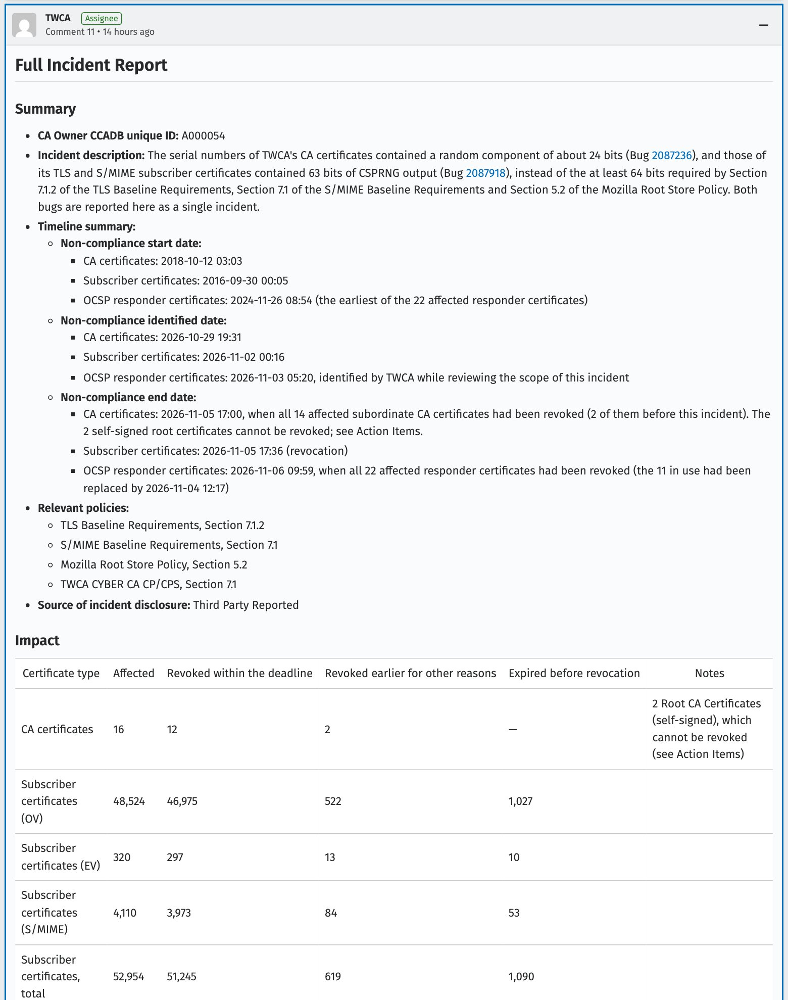
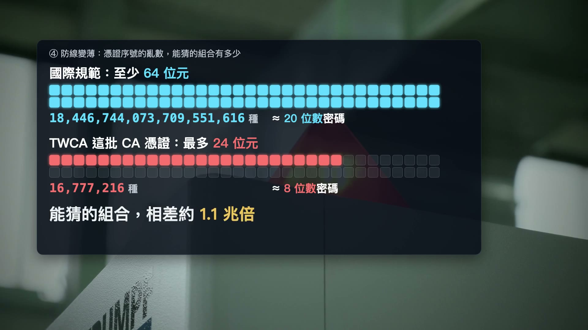

*11 月 4 日我們做了一支影片，講 TWCA 憑證事件四個嚴重的地方。11 月 12 日，TWCA 在 Mozilla 的憑證事件系統交出完整事件報告。這篇是後續整理，每個數字都附第一手出處，報告原文連結放在文末。*

<iframe width="560" height="315" src="https://www.youtube.com/embed/YQfwdcyqgy0" title="TWCA 憑證事件：四個嚴重的地方與五項要求" frameborder="0" allow="accelerometer; autoplay; clipboard-write; encrypted-media; gyroscope; picture-in-picture; web-share" referrerpolicy="strict-origin-when-cross-origin" allowfullscreen></iframe>

## 先講結論

TWCA 的報告承認了三件事。

第一，TWCA 簽發的網站憑證和電子郵件（S/MIME）憑證，序號亂數從 2016 年國際規範生效起就只有 63 位元，少了規定的 1 位元。原因是程式把 64 位元的亂數當成有正負號的整數，再取絕對值。

第二，CA 憑證（影片裡說的「分局印章」）一直沿用 2011 年的舊序號格式，亂數大約只有 24 位元。TWCA 推測，當年誤以為 64 位元的要求主要是管網站這類終端憑證。

第三，這兩個問題都是外部的人在 Mozilla 公開通報，TWCA 才正視的。

受影響的訂戶憑證一共 <strong>52,954 張</strong>，TWCA 在期限內處理完畢。但兩張自簽根憑證沒辦法撤銷，要等 Mozilla、Chrome 等根憑證計畫決定怎麼處理，截至 11 月 13 日早上，還沒有看到正式決定。

政府這邊，數發部做了緊急處置，也說要委託第三方檢測、調查違約。但是 11 月 6 日截止之後，政府憑證最後換好多少、連線驗證結果、962 個機關的名單、第三方檢測的時程，到今天都沒有公開。

*圖：TWCA 完整事件報告的摘要與影響表格。出處：[Mozilla Bugzilla 2087236 留言 11](https://bugzilla.mozilla.org/show_bug.cgi?id=2087236#c11)，2026-11-12 09:53 UTC 貼出，截圖供評論引用。*

## 一、到底多少張？先把口徑講清楚

完整報告的影響表格如下（單位都是「張憑證」）：

| 憑證類型 | 受影響 | 期限內撤銷 | 先前已因其他原因撤銷 | 撤銷前已過期 |
| --- | --- | --- | --- | --- |
| CA 憑證 | 16 | 12 | 2 | （2 張自簽根憑證無法撤銷） |
| 網站憑證 OV | 48,524 | 46,975 | 522 | 1,027 |
| 網站憑證 EV | 320 | 297 | 13 | 10 |
| 電子郵件憑證 S/MIME | 4,110 | 3,973 | 84 | 53 |
| <strong>訂戶憑證合計</strong> | <strong>52,954</strong> | <strong>51,245</strong> | <strong>619</strong> | <strong>1,090</strong> |
| OCSP 回應憑證 | 22 | 22 | — | — |

全部加起來是 52,992 張憑證。讀這些數字，有四件事要分清楚：

1. <strong>這是憑證張數，不是網站數，也不是機關數。</strong>一個網站可能用好幾張憑證，一張憑證也可能涵蓋好幾個網址，沒辦法換算成「多少個網站受影響」。
2. <strong>數字有修正過。</strong>11 月 6 日 TWCA 的進度回報寫的是：11/2 到 11/5，從受影響的中繼憑證撤銷了 52,816 張訂戶憑證（[留言 6](https://bugzilla.mozilla.org/show_bug.cgi?id=2087236#c6)）。完整報告重新盤點，改算「序號不合規、通報時還沒到期」的憑證，分成期限內撤銷、先前已撤銷、撤銷前過期三類，並明寫以新數字取代 11/6 的數字。
3. <strong>政府只是其中一部分。</strong>數發部 11 月 2 日公布，政府這邊是 962 個機關、9,772 張網站憑證（[數發部新聞稿](https://moda.gov.tw/press/press-releases/21226)）。金融業的部分，金管會資訊服務處說，銀行、證券、保險共向 TWCA 申請 4,190 筆憑證（工商時報 11/6 報導）。
4. <strong>撤銷完成，不等於換證完成。</strong>舊憑證作廢後，網站還要裝上新憑證、連同完整的憑證鏈，連線才會正常。

## 二、為什麼十年沒人發現：報告裡的三個原因

### 1. 一行 abs()，吃掉一個位元

TWCA 的線上簽發系統從 2014 年 10 月 30 日起，在網站憑證序號裡放 8 個位元組（64 位元）的亂數。問題出在程式把這個亂數當成「有正負號的 64 位元整數」，再用 `abs()` 取絕對值，最高的那個位元因此永遠是 0，實際只剩 63 位元。

國際規範（CA/Browser Forum 第 164 號決議）從 2016 年 9 月 30 日起要求至少 64 位元。從那天起到 2026 年 10 月 22 日，TWCA 簽發的網站和電子郵件憑證，序號都不合規。

### 2. 單看一張憑證，看不出亂數夠不夠

序號的長度是對的，只是其中一個位元永遠是 0。這種問題，檢查憑證格式的工具（linter）抓不到，要回頭看產生序號的程式才看得出來。

報告寫到兩次錯過的機會。2019 年 3 月，Google、GoDaddy 等憑證機構陸續爆出同一類序號亂數不足的問題，TWCA 當時自查程式碼，結論是符合規定。2021 年 11 月，TWCA 在 Mozilla 的公開論壇上表示，序號最後 8 個位元組由硬體安全模組隨機產生，符合 64 位元要求。兩次都沒有發現問題。

### 3. CA 憑證：2011 年的格式，一直沒改

CA 憑證由另一套離線系統簽發。序號格式從 2011 年用到 2024 年：開頭固定值、簽發日期、一串零、流水號，最後 3 個位元組才是亂數，大約 24 位元。

為什麼沒改？報告說 2016 年的紀錄已經找不到了，「依最佳推測」，當年 TWCA 誤以為 64 位元的要求主要是針對終端憑證。2023 年 TWCA 因為另一起事件，導入 CA 憑證簽發檢核表，查的是憑證欄位和 linter 結果；序號產生方式不是欄位，也就沒列進去。

*圖：64 位元和 24 位元差多少。出處：我們 11 月 4 日的影片字卡；位元數依 Bugzilla 2087236 研究人員通報與 CA/Browser Forum 規範。*

### 一段值得多看一眼的時間線：AI 改寫，順手修好了

報告裡有一段我讀了兩次。2026 年 7、8 月，TWCA 管理層因為 Bugzilla 上的事件太多，決定整合簽發系統，<strong>用 AI 協助改寫</strong>線上簽發系統的核心元件。新程式產生的序號剛好是 64 位元，10 月 22 日上線，等於順手修好了 63 位元的問題。但 TWCA 當時沒有意識到舊程式只有 63 位元，也沒發現離線系統簽的 CA 憑證有問題。

我一直主張 AI 要大膽用，用 AI 重寫老舊程式，這次確實有效。但是修好了卻沒人知道修了什麼，下一次就可能反過來：改寫時把對的改錯，一樣沒人發現。

所以報告裡的第 8 項改善，我認為最關鍵：參考美國 NIST SP 800-22 的亂數檢定，替產生序號的函式寫單元測試，而且要求「故意固定一個位元的測試版本必須測不過」。不管程式是人寫的還是 AI 寫的，要能被驗證才算數。

## 三、時間線（台北時間）

- <strong>2011-06-10</strong>：最早一張用舊格式（約 24 位元亂數）的 CA 憑證簽發。
- <strong>2014-10-30</strong>：線上系統開始在網站憑證序號放 8 位元組亂數，實際只有 63 位元。
- <strong>2016-09-30</strong>：64 位元規範生效，兩套序號程式都沒有改。
- <strong>2018-10-12</strong>：規範生效後，第一張用舊格式的 CA 憑證簽發。
- <strong>2019-03</strong>：其他憑證機構爆出同類問題，TWCA 自查，結論是符合規定。
- <strong>2021-11-02</strong>：TWCA 在 Mozilla 公開論壇表示序號符合 64 位元要求。
- <strong>2026-07～08</strong>：用 AI 協助改寫線上簽發系統。
- <strong>2026-10-22 15:37</strong>：改寫後的系統上線，此後簽發的網站憑證序號合規。
- <strong>2026-10-30 03:31</strong>：兩位外部研究人員在 Bugzilla 通報 CA 憑證序號問題（2087236）。
- <strong>2026-10-30 17:30</strong>：TWCA 緊急修改離線系統的序號產生方式，改用跟線上系統相同的邏輯。
- <strong>2026-10-30 18:48</strong>：TWCA 建立新的根憑證 TWCA CYBER Root CA G3。
- <strong>2026-11-02 08:16</strong>：另一位研究人員通報網站憑證序號只有 63 位元（2087918）。
- <strong>2026-11-03 13:20</strong>：TWCA 自己發現，負責回應憑證狀態查詢的 OCSP 回應憑證也有同樣問題。
- <strong>2026-11-06 01:00</strong>：12 張受影響的 CA 憑證撤銷。
- <strong>2026-11-06 01:36</strong>：尚未到期的受影響訂戶憑證全部撤銷完成。
- <strong>2026-11-06 17:59</strong>：22 張受影響的 OCSP 回應憑證全部撤銷。
- <strong>2026-11-12 17:53</strong>：完整事件報告貼上 Bugzilla，比原定的 11/13 03:00 早。

報告原文用世界協調時間（UTC），上面已換算成台北時間（加 8 小時）。

## 四、兩張根憑證：還在等瀏覽器決定

TWCA CYBER Root CA 和 TWCA Global Root CA G2 這兩張自簽根憑證，是 2022 年簽的，序號也是舊格式。根憑證沒有上一層可以撤銷它，報告把它們列為唯二「仍然有效」的受影響憑證。TWCA 的處理計畫（改善項目第 3 項）是：用同一把金鑰、換新序號重新簽發，照根憑證計畫的指引辦理，期限要等收到指引後再訂。

報告也交代了這段過程：

- 10 月 30 日，TWCA 先寫信給 Microsoft、Mozilla、Chrome、Apple 四個根憑證計畫，提議用原金鑰重簽根憑證。
- 規劃時發現，CYBER Root 的名稱裡有一個現行規範不允許重簽根憑證保留的欄位，重簽會改變名稱、讓既有的憑證鏈接不起來；Microsoft 的規則也要求新根憑證用新金鑰、新名稱。
- 因為中繼憑證 7 天內就得撤銷，TWCA 在 10 月 30 日傍晚決定不等回覆，先建新的根憑證 G3。當晚 Chrome 回覆，願意在一般的根憑證清單更新中，以非緊急變更處理原金鑰重簽的根憑證；10 月 31 日 Mozilla 回覆，表示知悉新計畫，願意優先審查新的根憑證。
- 現在 TLS 網站憑證改由 TWCA CYBER Root CA G3 體系簽發，電子郵件憑證改由新的 TWCA SMIME Root CA G1 體系簽發。新根憑證還沒被收進瀏覽器之前，信任路徑靠舊的 TWCA Global Root CA 簽發的交互憑證接上。

Chrome 根憑證計畫 11 月 4 日也向 TWCA 提了一串問題，報告逐一回答，其中幾點值得記下來：

- TWCA 承認，處理期間沒有及時、完整地讓 Chrome 知道每一次的顧慮和計畫變更；11 月 4 日寄給根憑證計畫的信，憑證路徑和決策理由都寫錯了，11 月 5 日才更正。
- 新的中繼憑證沿用跟 2024 年那批一樣的名稱，TWCA 承認這不符合規範的本意，承諾之後的世代改用不同名稱（12 月 31 日前寫進作業程序）。
- 新 CA 憑證的序號剛好是 64 位元亂數，一點餘裕都沒有，TWCA 承諾 12 月 31 日前改成超過 64 位元。

截至 11 月 13 日早上，Bugzilla 上看不到 Mozilla 或 Chrome 對這兩張舊根憑證的正式決定。

## 五、有沒有被駭？

序號亂數不足，跟「被駭」是兩回事。

- 通報的研究人員一開始就寫：沒有證據顯示金鑰外洩、憑證被濫用或遭到利用；序號太短，本身不會讓人能偽造 SHA-256 簽章的憑證。
- TWCA 報告說，沒有發現亂數不足被利用、或造成任何資安事件的跡象；受影響的憑證都用 SHA-256 或 SHA-384 簽章，目前沒有公開可行的碰撞攻擊。
- 數發部 11 月 2 日也說，目前沒有造成具體資安危害。

序號亂數是防偽造的第二道鎖。第一道鎖還在，第二道鎖少了一大塊，本來就不應該發生，這也是規範要求限期撤銷的原因。

## 六、另一張事件單：RA 伺服器遭未授權存取

這跟序號問題是兩件事，但同一段時間發生，一起記下來。

10 月 29 日，TWCA 自己在 Bugzilla 通報：負責受理憑證申請的 RA 伺服器出現未授權存取的跡象（[2086949](https://bugzilla.mozilla.org/show_bug.cgi?id=2086949)）。11 月 10 日（UTC 11/9）的完整報告寫到：

- 一套原定 5 月 29 日下線、實際上還在運作的舊 RA 服務，使用的第三方元件有遠端程式執行漏洞，10 月 26 日深夜被人從網路上利用，取得伺服器上的應用程式權限。
- 對方再用 2022 年升級時留下、沒有加密的設定檔備份裡的資料庫帳密，連進後端資料庫，查了表格結構、帳號權限和資料筆數。
- TWCA 說，稽核紀錄沒有修改或匯出資料的操作；逐筆比對 10 月 26 日到 28 日簽發的 553 張憑證，沒有未經授權的簽發；也沒有找到個資被取走的證據。當時預防性暫停簽發 4 小時 52 分。

報告也承認幾個管理上的漏洞：這個漏洞在 5 月 14 日滲透測試、8 月 7 日弱點掃描之前就已經公開，兩次都沒抓到；異常警報 10 月 26 日 23:52 就發出，值班人員隔天早上 6:58 才開始處理。對應的改善項目，期限排到 2027 年 1 月底。

## 七、政府這邊：做了這些，但是

先講數發部做了什麼：

- 10 月 30 日接獲通報後，要求 TWCA 兩天內產製新憑證。11 月 1 日完成政府 9,772 張憑證的重新產製，直接用電子郵件寄給原申請的承辦人，並請各機關資訊主管督促（數發部 11/2 新聞稿）。
- 委託獨立第三方專業機構深入檢測 TWCA，依結果要求改善；也要調查違約情事，依約罰款及求償（同一則新聞稿）。
- 截止前一天，11 月 5 日下午 5 點，數發部說 9,772 張已有 85% 完成更新，約 1,460 張待更新（鏡週刊 11/5 報導數發部統計）。
- 金融業：金管會說，截至 11 月 5 日下午 2 點半，已有 9 成 5 更換憑證（工商時報 11/6 報導）。

但是，有幾件事到今天都沒有交代：

- <strong>截止後的最終數字。</strong>截至 11 月 13 日，我們在數發部官網查到跟 TWCA 有關的新聞稿，仍然只有 11 月 2 日那一則。截止前最後一個數字是 85%，剩下約 1,460 張後來換好了沒有？連線驗證通過多少？962 個機關的名單或分類統計？都沒有公布。
- <strong>截止隔天的安全警告。</strong>TWCA 自己在報告裡寫，到撤銷期限時，部分手動管理憑證的客戶還沒換好，隔天有些網站跳出安全警告。是哪些網站、有沒有政府或金融服務、影響多久，報告沒寫，政府也沒有說明。
- <strong>第三方檢測和違約調查。</strong>檢測範圍、時程、違約調查和罰款的結果，都還沒公布。TWCA 自己列了 10 項改善，有 7 項還在進行，期限多半在 12 月底；政府的檢測要不要逐項驗收，應該講清楚。

我們 11 月 4 日抽查過 54 個常用網站：下午 1 點，用 TWCA 憑證的 38 個裡有 12 個還在送出要作廢的舊中繼憑證；傍晚 5 點 47 分剩 3 個。這只是抽樣，但說明了一件事：換證到最後幾天，還是靠人工一個一個追。去年中華電信、今年 TWCA，同樣的事一年發生兩次，監察院今年 4 月的調查報告也寫過，所謂雙憑證「並非自動化備援」。

所以我們在影片裡提的五項要求，現在都還成立。最急的是三件：

1. 公布截止後的最終數字：換證完成率、連線驗證結果、受影響機關的分類統計。
2. 公布第三方檢測報告和違約處理結果，對照 TWCA 的 10 項改善逐項驗收。
3. 重要政府系統做到跨憑證機構備援，導入 ACME 自動申請、更新、部署，定期演練切換。

## 最後

這次 TWCA 在期限內撤銷了受影響的憑證，報告也比期限早交，內容寫得相當坦白，連「沒有及時讓 Chrome 知道」都寫進去了，這點值得肯定。

但兩個問題都是外部的人抓到的，內部十年沒發現；政府這邊緊急處置做了，最後一哩還沒交代。兩張舊根憑證怎麼處理、第三方檢測結果，我會持續追蹤，有新進展再更新。

---

## 出處

- TWCA 完整事件報告：[Mozilla Bugzilla 2087236 留言 11](https://bugzilla.mozilla.org/show_bug.cgi?id=2087236#c11)（2026-11-12 09:53 UTC），附件 [CA 憑證清單](https://bugzilla.mozilla.org/attachment.cgi?id=9679812)、[網站憑證清單](https://bugzilla.mozilla.org/attachment.cgi?id=9679814)、[電子郵件憑證清單](https://bugzilla.mozilla.org/attachment.cgi?id=9679813)、[OCSP 回應憑證清單](https://bugzilla.mozilla.org/attachment.cgi?id=9679815)
- TWCA 進度回報（11/5 撤銷、52,816 張）：[Bugzilla 2087236 留言 6](https://bugzilla.mozilla.org/show_bug.cgi?id=2087236#c6)（2026-11-06 08:51 UTC）
- 外部研究人員原始通報（Prasanth Sundararajan、Angelique Faye Loe）：[Bugzilla 2087236 留言 0](https://bugzilla.mozilla.org/show_bug.cgi?id=2087236#c0)（2026-10-29 19:31 UTC）
- 網站憑證 63 位元通報：[Bugzilla 2087918](https://bugzilla.mozilla.org/show_bug.cgi?id=2087918)（2026-11-02 00:16 UTC，已併入 2087236）
- OCSP 回應憑證：[Bugzilla 2080273 留言 5](https://bugzilla.mozilla.org/show_bug.cgi?id=2080273#c5)
- RA 伺服器事件完整報告：[Bugzilla 2086949 留言 2](https://bugzilla.mozilla.org/show_bug.cgi?id=2086949#c2)（2026-11-09 21:51 UTC）、[留言 4](https://bugzilla.mozilla.org/show_bug.cgi?id=2086949#c4)
- 數位發展部新聞稿〈數發部已督促TWCA完成產製符合標準新憑證 籲各機關儘速更新〉2026-11-02：[moda.gov.tw/press/press-releases/21226](https://moda.gov.tw/press/press-releases/21226)
- 數發部 11/5 下午 5 點更新進度 85%：[鏡週刊 2026-11-05](https://www.mirrormedia.mg/story/20261105-177fin-172426)
- 金管會：金融業 4,190 筆憑證、11/5 14:30 九成五完成：[工商時報 2026-11-06](https://www.ctee.com.tw/news/20261106700161-439901)
- CA/Browser Forum Ballot 164（2016-09-30 起序號至少 64 位元 CSPRNG 輸出）、TLS Baseline Requirements 7.1：[cabforum.org](https://cabforum.org)
- 監察院調查報告（2026-04-14 通過）：[cybsbox.cy.gov.tw](https://cybsbox.cy.gov.tw/CYBSBoxSSL/edoc/download/76191)
- 我們的影片（含 11/4 抽查方法與完整名單，見說明欄）：[youtu.be/YQfwdcyqgy0](https://youtu.be/YQfwdcyqgy0)
